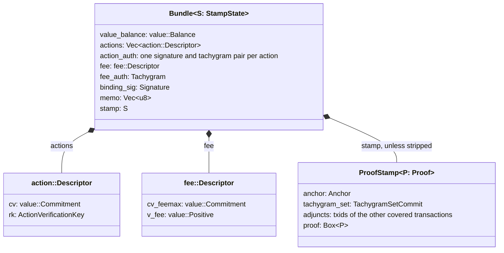

# Tachyon

Tachyon is a shielded transaction protocol for Zcash. It aims to reduce the
cost of shielded transactions to the chain.

This repository holds the reference implementation, in the `zcash_tachyon`
crate, and [The Tachyon Book](book), which describes the protocol. Both are
work in progress, and the crate's API changes without notice.

## Transaction structure

A bundle holds actions and a stamp. Each action has a signature and a pair of
tachygrams. A tachygram stands for a nullifier or a note commitment, and
consensus treats both alike.

The stamp carries a [Ragu](https://github.com/tachyon-zcash/ragu) proof that
the bundle's actions follow the rules. Stamps can be merged into one stamp that
covers several bundles, and the other bundles are stripped of their stamps.



A bundle's stamp state `S` is either `ProofStamp` or `StrippedStamp`, which
has no fields. The book's [Bundles](book/src/bundle.md) chapter explains each
field.

## Development

Requires stable Rust 1.97 or later and [`just`](https://github.com/casey/just).
Formatting uses the pinned toolchain `nightly-2026-05-23`.

```sh
just test          # unit tests, then integration tests and doctests with --release
just lint          # build the docs, then clippy for no_std and for all targets
just fmt           # format with the pinned nightly
just check         # cargo check for no_std and for all targets
just doc --open    # build and open the crate's rustdoc
just book serve    # serve the book, after installing mdbook and its plugins
just ci_local      # the Rust CI gates, without the OS matrix
```

Unit and integration tests build with the `test-epoch-size` feature, which shortens an epoch from
4096 blocks to 64. Only `tests/epoch.rs` runs at the shipped epoch size, and
only `just ci_local` runs it.

## License

MIT OR Apache-2.0
