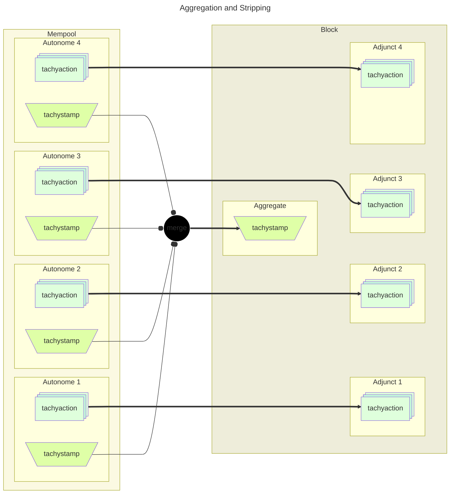

# Aggregation

Instead of verifying each transaction individually, transaction proofs may be recursively merged into a single proof that covers many transactions.
This is how Tachyon seeks to reduce chain costs.

The act of merging proofs is **aggregation**, and **aggregators** are nodes enganged in this activity creating **aggregate** transactions.

Miners are likely to vertically integrate aggregation.

## Bundle States

Transactions with no Tachyon bundle[^bundle-format] are not covered here.

Aggregation creation of a new transaction with a proof that can replace the proof in a selection of other transactions.
To create a valid block with a given aggregate, a miner must include all of those other transactions, sans their now-redundant proofs.

So Tachyon bundles have two main states: **stamped** or **stripped**.

These two states do not correspond perfectly with 'aggregate' and 'not aggregate', so we establish some nomenclature:

| Term | State | Provenance | Validation |
| ---- | ----- | ---------- | ---------- |
| **autonome** | stamped | wallet | Complete proof with all inputs |
| **aggregate** | stamped | aggregator | Merged proof needs input from other transactions |
| **adjunct** | stripped | miner | Input to merged proof from another transaction |

Aggregates may be further named:

- *innocent* aggregate containing no Tachyon actions.  
  For example, an aggregate transaction might only contain activity in other pools, or no activity at all.
- *based* aggregate proving its own Tachyon actions.  
  For example, a miner's coin*base* transaction might be an aggregate, and also output miner rewards via Tachyon action.

When stripped, an innocent contributes no actions but still names a covering transaction: its `tachyonAggregateId` is a nonzero reference to the aggregate that absorbed its stamp, never the all-zero `wtxid`.
It retains its fee descriptor and binding signature.

[^bundle-format]: See [Bundles](./bundle.md) to understand bundle format.

## Aggregation Process

### Merge to produce Aggregate

A proof's wire format is compressed for bandwidth efficiency.
Aggregators must decompress proofs to a mutable format in order to merge proofs, and then re-compress to broadcast.

Aggregators collect autonomes or existing aggregates and merge their stamps:

1. Select transactions
2. Deserialize and validate stamps
3. Match/update anchors
4. Merge stamps
   - Merge tachygrams (exclusive sets)
   - Merge proofs
5. For an innocent aggregate, prove its own zero fee with `FeeSeed` and merge the others' stamps into it
6. Serialize and compress the merged stamp
7. Publish aggregate transaction

An innocent aggregate is a bundle with its own [max fee note](./fee.md#max-fee-note), so its stamp covers its own fee descriptor as well as the adjuncts'. Its stamp comes from an empty `Plan::prove`, which runs `FeeSeed`, and then absorbs the adjuncts' stamps with `ProofStamp::merge`.

<!-- TODO
- Explain tachygram set union validation algorithm
- Define aggregation limits
-->

### Strip to produce Adjuncts {#strip-to-produce-adjuncts}

Miners obtain the broadcast aggregates, or by vertically integrating as aggregators.

When authoring a block, miners remove stamps from transactions covered by an aggregate, to produce appropriate adjuncts, and assign the adjunct a reference to the `wtxid` of the aggregate.

## Action set indicator

An aggregate's stamp proves its own actions together with every covered adjunct's actions, but carries no proof header: a verifier reconstructs the header from the covered actions. Within a block that material is all at hand, since each adjunct points to its aggregate by `wtxid`. Before block inclusion it is not: aggregators publish only their merged transactions, and the ambiguity between actions and tachygrams makes a nearly-complete collection of adjuncts hard to recognize without falling back on full proof verification.

To make that recognition cheap, the stamp trailer carries `hStampCoverageTachyon`, an assistive indicator the transaction author provides (see [Bundles → Wire Format](./bundle.md#stamp-trailer)). It is a BLAKE2b-256 digest of two sub-digests: `hStampActionsTachyon` over the sorted `cv || rk` descriptors of every action the stamp covers, and `hStampFeesTachyon` over the sorted `cv_maxfee || LE64(fee)` of every [fee descriptor](./fee.md) it covers. With it, an observer can cheaply tell an autonome from an aggregate and judge whether a collection of adjuncts is complete, without verifying the proof. The proof binds the same actions and fee descriptors as a Pedersen commitment to their Poseidon digests; recomputing the trailer digest is the cheap check, and it is a separate construction over the same set rather than a copy of the one the proof carries.

A stripped adjunct keeps its fee descriptor: `cvFeeMaxTachyon` in the bundle body and `vFeeTachyon` in the stripped trailer. The covering verifier collects every covered fee descriptor from the published bundles.

The indicator is authorization data, not effecting data: it rides on the strippable stamp trailer, contributes to `auth_digest`, and is absent from adjuncts. It is not a soundness mechanism. The proof binds the action set regardless; a wrong indicator only harms its author, since mempool actors decline to handle a transaction whose indicator they cannot satisfy, and a subset, superset, or partial overlap simply fails to validate.

Coverage verification uses it as the first of two fast-fail gates. It recomputes the digest over the candidate collection's action descriptors and fee descriptors and, on disagreement with the carried `hStampCoverageTachyon`, fails before attempting the expensive proof verification. It then checks the tachygram arity, `nTachygrams == 2 * covered actions + covered bundles`, which the fixed ratios make an exact test: a stamp short of the arity has reused a tachygram, since the published tachygrams are a set.

<!-- TODO
p2p aggregation gossip is a secondary objective and aggregation has some complex constraints.

- aggregate size is limited by commitment size before block size (on the order of thousands of actions)
- desirable to reduce the number of stamps in tx, for size, bandwidth, and validation cost
- merging to one aggregate cannot be parallelized, but multiple aggregates may be built in parallel
- serialization/deserialization is expensive and stamps are only mutable when 'decompressed'
- does ser/de cost scale with size?
- 'merge small autonome stamp' and 'merge large aggregate stamp' are about the same cost

1. Are there some 'optimal' qualities for aggregates?
2. Will miners prefer to rely on p2p, or integrate aggregation?
3. Will miners selecting aggregates from p2p prefer certain qualities?
4. Will miners selecting aggregates from p2p prefer to:
   - select aggregates and then seek the related transactions, or
   - select transactions and then seek an appropriate aggregate?
-->
