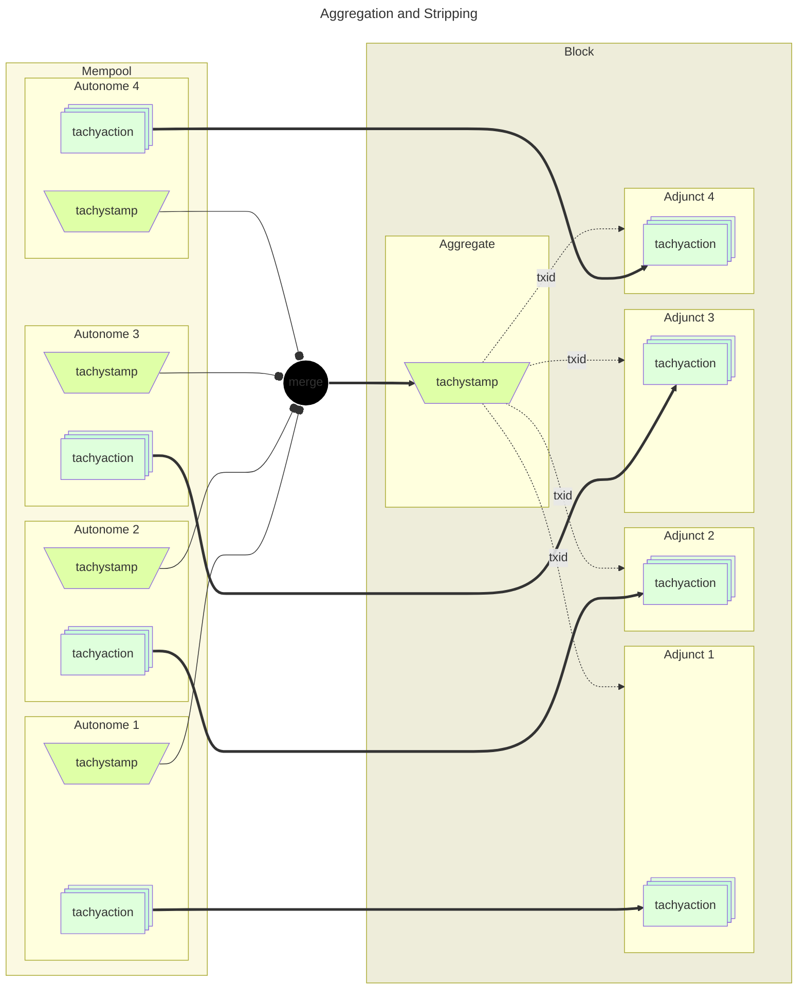

# Aggregation

Instead of verifying each transaction individually, transaction proofs may be recursively merged into a single proof that covers many transactions.
This is how Tachyon seeks to reduce chain costs.

The act of merging proofs is **aggregation**, and **aggregators** are nodes engaged in this activity creating **aggregate** transactions.

Miners are likely to vertically integrate aggregation.

## Bundle States

Transactions with no Tachyon bundle[^bundle-format] are not covered here.

Aggregation is the creation of a new transaction with a proof that can replace the proof in a selection of other transactions.
To create a valid block with a given aggregate, a miner must include all of those other transactions, sans their now-redundant proofs.

So Tachyon bundles have two main states: **stamped** or **stripped**.

These two states do not correspond perfectly with 'aggregate' and 'not aggregate', so we establish some nomenclature:

| Term | State | Provenance | Validation |
| ---- | ----- | ---------- | ---------- |
| **autonome** | stamped | wallet | Complete proof with all inputs |
| **aggregate** | stamped | aggregator | Merged proof needs input from other transactions |
| **adjunct** | stripped | miner | Input to merged proof from another transaction |

Aggregates may be further named:

- *innocent* aggregate containing no Tachyon actions.  
  For example, an aggregate transaction might only contain activity in other pools, or no activity at all.
- *based* aggregate proving its own Tachyon actions.  
  For example, a miner's coin*base* transaction might be an aggregate, and also output miner rewards via Tachyon action.

When stripped, an innocent contributes no actions.
It retains its fee descriptor and binding signature, and the aggregate that covers it lists its `txid` like any other adjunct's.

[^bundle-format]: See [Bundles](./bundle.md) to understand bundle format.

## Aggregation Process

### Merge to produce Aggregate

Before the block, a stamp's wire format carries the full proof, so aggregators can lift and merge decoded stamps directly.
A block carries each aggregate with its proof compressed, which is smaller but can no longer be lifted or merged.

Aggregators collect autonomes or existing aggregates and merge their stamps:

1. Select transactions
2. Deserialize and validate stamps
3. Match/update anchors
4. Merge stamps
   - Merge tachygrams (exclusive sets)
   - Merge proofs
   - List the `txid` of the one transaction the absorbed stamp covers without listing
5. For an innocent aggregate, prove its own zero fee with `FeeSeed` and merge the others' stamps into it
6. Compress the merged stamp for the block
7. Publish aggregate transaction with its [adjunct list](#adjunct-list)

An innocent aggregate is a bundle with its own [max fee note](./fee.md#max-fee-note), so its stamp covers its own fee descriptor as well as the adjuncts'. Its stamp comes from an empty `Plan::prove`, which runs `FeeSeed`, and then absorbs the adjuncts' stamps with `ProofStamp::merge`.

Tachygrams covered by a stamp must be distinct.
[Bundle validation](./bundle.md#stamp-trailer) derives their union from the covered actions' pairs and covered bundles' fee changes, rejects repeated members, and checks its commitment.
[`StampMerge`](./proof-tree.md#stamp-construction) proves the merged set polynomial is the product of its inputs, so a tachygram shared by two inputs is a repeated root.
Validation recomputes `cTachygrams` from the derived union, so such a stamp fails verification.
An honest aggregator never merges stamps whose tachygram sets overlap.

The derived union holds at most $2^{13} - 1$ tachygrams, so one aggregate covers at most 4,095 actions, with each covered bundle's fee change also taking space.
This follows from Ragu's production rank and is not a policy limit.

### Strip to produce Adjuncts {#strip-to-produce-adjuncts}

Miners obtain the broadcast aggregates, or by vertically integrating as aggregators.

Stripping removes the stamp from a transaction covered by an aggregate, producing an adjunct.
The miner strips each transaction an aggregate in its block lists.
Stripping takes nothing and writes nothing, and the adjunct's bytes depend on that bundle alone.

### What a mempool node checks

A relayed aggregate arrives with its list, and the transactions it lists sit in the mempool, stamped.
A mempool node:

1. Looks up each listed `txid`, and holds off while any is missing.
2. Relies on each listed transaction having been accepted on its own stamp.
   Nothing in a mempool is unproven, so rule B below has no mempool form.
3. Strips a copy of each and verifies the aggregate with them.
   This is the check a block validator runs, on the bytes a block holds.
4. Strips a listed transaction that is itself an aggregate like any other.
   Its own list goes with its stamp, and the outer list already names those transactions.

The aggregate then replaces the stamps of exactly the listed transactions.
An aggregate and the stamped form of a transaction it lists are alternatives: a block holds that transaction stripped under the aggregate or stamped without it.
Two aggregates that list one transaction are alternatives, and a block takes at most one of them (rule C).

### Block rules

A block validator checks every adjunct list against the block with three rules:

- **A.** Every listed `txid` is a transaction in the same block whose Tachyon bundle is stripped.
- **B.** Every stripped bundle in the block is listed at least once.
- **C.** No stripped bundle is listed more than once.

Skipping rule B mints value.
An unlisted stripped bundle is a set of actions with no stamp proof, and no other rule catches it.
A stripped bundle carries no field that prompts the check, so a validator that walks only proof stamps and their lists never visits an unlisted one.

Rule C has a backstop.
A bundle covered by two stamps puts its tachygrams, including at least its fee change, into two unions, and the block's rule against repeated tachygrams rejects them.

A validator indexes the block's stripped bundles by `txid`.
For each proof stamp it takes the listed bundles out of the index and verifies the stamp with them.
It fails if a listed `txid` is absent (rule A) or already taken (rule C), or if any stripped bundle is left in the index at the end (rule B).
The rules rely on a `txid` naming one transaction within a block.

Node test vectors:

- A block with an aggregate that lists a `txid` absent from the block is invalid (rule A).
- A block with an aggregate that lists the `txid` of a transaction whose Tachyon bundle is stamped is invalid (rule A).
- A block with a valid aggregate and one stripped bundle that no stamp lists is invalid (rule B).
- A block with two aggregates, each valid with its adjuncts, that both list one stripped bundle is invalid (rule C).

## Adjunct list {#adjunct-list}

An aggregate's stamp proves its own actions together with every covered adjunct's actions, but carries no proof header.
A verifier reconstructs the header from the covered bundles.
The stamp's `vAdjunctsTachyon` lists the `txid` of every other transaction whose bundle it covers (see [Bundles → Wire Format](./bundle.md#stamp-trailer)), so a node gathers the covered bundles by lookup.
In the mempool those transactions are still stamped, and in a block they are stripped.
The carrying bundle is never in its own list, and an autonome's list is empty.

The list is authorization data.
It contributes to `auth_digest` through the stamp digest, and neither the stamp proof nor a signature binds it.
`merge` and `unmerge` write it, taking from the caller the `txid` of the one transaction the other stamp covers without listing.
A quotient that has no transaction it covers without listing has no such `txid` (see [Aggregator → When a block lands](./network_roles/aggregator.md#when-a-block-lands)).

Moving an aggregate to another host is `merge` then `unmerge`.
The new host absorbs the aggregate with its host's `txid`, which lists that host and everything the aggregate listed, then divides out the old host's own stamp with the same `txid`.

A wrong list carries no soundness risk.
A listed bundle the stamp does not cover adds to the derived tachygram union, and a covered bundle the list omits is missing from it, so verification fails either way.

A `txid` names a transaction and not one of its authorization forms.
Several forms of one `txid` can sit in a mempool, differing in fee, fee change or pairs.
A node strips the form it holds and verifies the aggregate with it.
A wrong form fails before stamp proof verification, at the tachygram set check or at the stamp proof's output slot comparison.

A stripped adjunct keeps its entire bundle body, including `cvFeeMaxTachyon`, `vActionTachygramsTachyon`, `vFeeTachyon`, and `cmChangeTachyon`. Its trailer is empty. The covering verifier collects the pairs and fee descriptors from the published bodies.

Coverage verification walks the covered bundles once, before attempting stamp proof verification.
It bounds the covered tachygrams, rejects a repeated action descriptor, fee descriptor or tachygram, and checks `cTachygrams` against the union of all covered action pairs and fee changes.
It does not read the list.

<!-- TODO
p2p aggregation gossip is a secondary objective and aggregation has some complex constraints.

- desirable to reduce the number of stamps in tx, for size, bandwidth, and validation cost
- merging to one aggregate cannot be parallelized, but multiple aggregates may be built in parallel
- serialization/deserialization is expensive and stamps are only mutable when 'decompressed'
- does ser/de cost scale with size?
- 'merge small autonome stamp' and 'merge large aggregate stamp' are about the same cost

1. Are there some 'optimal' qualities for aggregates?
2. Will miners prefer to rely on p2p, or integrate aggregation?
3. Will miners selecting aggregates from p2p prefer certain qualities?
4. Will miners selecting aggregates from p2p prefer to:
   - select aggregates and then seek the related transactions, or
   - select transactions and then seek an appropriate aggregate?
-->
