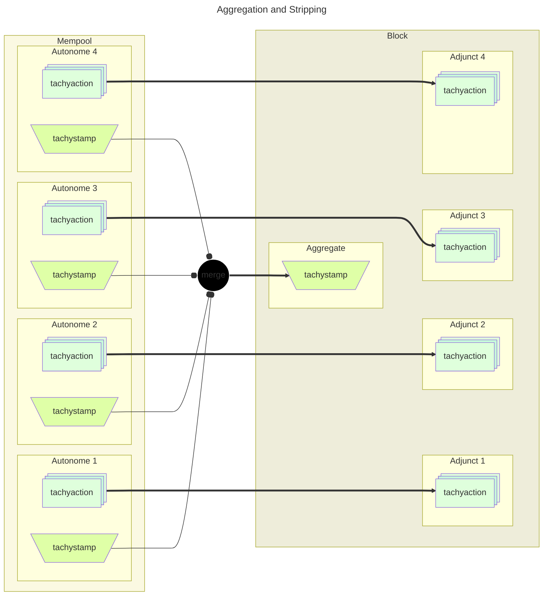

# Aggregation

Instead of verifying each transaction individually, transaction proofs may be recursively merged into a single proof that covers many transactions.
This is how Tachyon seeks to reduce chain costs.

The act of merging proofs is **aggregation**, and **aggregators** are nodes engaged in this activity creating **aggregate** transactions.

Miners are likely to vertically integrate aggregation.

## Bundle States

Transactions with no Tachyon bundle[^bundle-format] are not covered here.

Aggregation is the creation of a new transaction with a proof that can replace the proof in a selection of other transactions.
To create a valid block with a given aggregate, a miner must include all of those other transactions, sans their now-redundant proofs.

So Tachyon bundles have two main states: **stamped** or **stripped**.

These two states do not correspond perfectly with 'aggregate' and 'not aggregate', so we establish some nomenclature:

| Term | State | Provenance | Validation |
| ---- | ----- | ---------- | ---------- |
| **autonome** | stamped | wallet | Complete proof with all inputs |
| **aggregate** | stamped | aggregator | Merged proof needs input from other transactions |
| **adjunct** | stripped | miner | Input to merged proof from another transaction |

Aggregates may be further named:

- *innocent* aggregate containing no Tachyon actions.  
  For example, an aggregate transaction might only contain activity in other pools, or no activity at all.
- *based* aggregate proving its own Tachyon actions.  
  For example, a miner's coin*base* transaction might be an aggregate, and also output miner rewards via Tachyon action.

When stripped, an innocent contributes no actions but still names a covering transaction: its `tachyonAggregateId` is a nonzero reference to the aggregate that merged its stamp, never the all-zero `wtxid`.
It retains its fee descriptor and binding signature.

[^bundle-format]: See [Bundles](./bundle.md) to understand bundle format.

## Aggregation Process

### Merge to produce Aggregate

Before the block, a stamp's wire format carries the full proof, so aggregators can lift and merge decoded stamps directly.
A block carries each aggregate with its proof compressed, which is smaller but can no longer be lifted or merged.

Aggregators collect autonomes or existing aggregates and merge their stamps:

1. Select transactions
2. Deserialize and validate stamps
3. Match/update anchors
4. Merge stamps
   - Merge tachygrams (exclusive sets)
   - Merge proofs
5. For an innocent aggregate, prove its own zero fee with `FeeSeed` and merge the others' stamps into it
6. Compress the merged stamp for the block
7. Publish aggregate transaction

An innocent aggregate is a bundle with its own [max fee note](./fee.md#max-fee-note), so its stamp covers its own fee descriptor as well as the adjuncts'. Its stamp comes from an empty `Plan::prove`, which runs `FeeSeed`, and then absorbs the adjuncts' stamps with `ProofStamp::merge`.

Tachygrams covered by a stamp must be distinct.
[Bundle validation](./bundle.md#stamp-trailer) derives their union from the covered actions' pairs and covered bundles' fee changes, rejects repeated members, and checks its commitment.
[`StampMerge`](./proof-tree.md#stamp-construction) proves the merged set polynomial is the product of its inputs, so a tachygram shared by two inputs is a repeated root.
Validation recomputes `cTachygrams` from the derived union, so such a stamp fails verification.
An honest aggregator never merges stamps whose tachygram sets overlap.

The derived union holds at most $2^{13} - 1$ tachygrams, so one aggregate covers at most 4,095 actions, with each covered bundle's fee change also taking space.
This follows from Ragu's production rank and is not a policy limit.

### Strip to produce Adjuncts {#strip-to-produce-adjuncts}

Miners obtain the broadcast aggregates, or by vertically integrating as aggregators.

When authoring a block, miners remove stamps from transactions covered by an aggregate, to produce appropriate adjuncts, and assign the adjunct a reference to the `wtxid` of the aggregate.

## Action set indicator

An aggregate's stamp proves its own actions together with every covered adjunct's actions, but carries no proof header: a verifier reconstructs the header from the covered bundles. Within a block that material is all at hand, since each adjunct points to its aggregate by `wtxid`. Before block inclusion, an observer needs a way to recognize a complete collection of candidate adjuncts without full proof verification.

To make that recognition cheap, the stamp trailer carries `hStampCoverageTachyon`, an assistive indicator the transaction author provides (see [Bundles → Wire Format](./bundle.md#stamp-trailer)). It is a BLAKE2b-256 digest of two sub-digests: `hStampActionsTachyon` over the sorted `cv || rk` descriptors of every action the stamp covers, and `hStampFeesTachyon` over the sorted `cv_feemax || LE64(fee)` coverage entries of every [fee descriptor](./fee.md) it covers. The indicator excludes action pairs and fee changes. With it, an observer can cheaply tell an autonome from an aggregate and judge whether a collection of adjuncts is complete, without verifying the stamp proof. The stamp proof binds the descriptors together with their tachygrams through a Pedersen commitment to their Poseidon digests.

A stripped adjunct keeps its action pairs and fee descriptor: `cvFeeMaxTachyon` in the bundle body, and `vFeeTachyon` and `cmFeeChangeTachyon` in the stripped trailer. The covering verifier collects these from the published bundles.

The indicator is authorization data, not effecting data: it rides on the strippable stamp trailer, contributes to `auth_digest`, and is absent from adjuncts. It is not a soundness mechanism. The proof binds the action set regardless; a wrong indicator only harms its author, since mempool actors decline to handle a transaction whose indicator they cannot satisfy, and a subset, superset, or partial overlap simply fails to validate.

Coverage verification recomputes the indicator over the candidate collection's action descriptors and fee coverage entries and fails on disagreement before attempting stamp proof verification. Tachygram validation derives the union of all covered action pairs and fee changes, rejects repeated members and an oversized union, and checks `cTachygrams`.

<!-- TODO
p2p aggregation gossip is a secondary objective and aggregation has some complex constraints.

- desirable to reduce the number of stamps in tx, for size, bandwidth, and validation cost
- merging to one aggregate cannot be parallelized, but multiple aggregates may be built in parallel
- serialization/deserialization is expensive and stamps are only mutable when 'decompressed'
- does ser/de cost scale with size?
- 'merge small autonome stamp' and 'merge large aggregate stamp' are about the same cost

1. Are there some 'optimal' qualities for aggregates?
2. Will miners prefer to rely on p2p, or integrate aggregation?
3. Will miners selecting aggregates from p2p prefer certain qualities?
4. Will miners selecting aggregates from p2p prefer to:
   - select aggregates and then seek the related transactions, or
   - select transactions and then seek an appropriate aggregate?
-->
