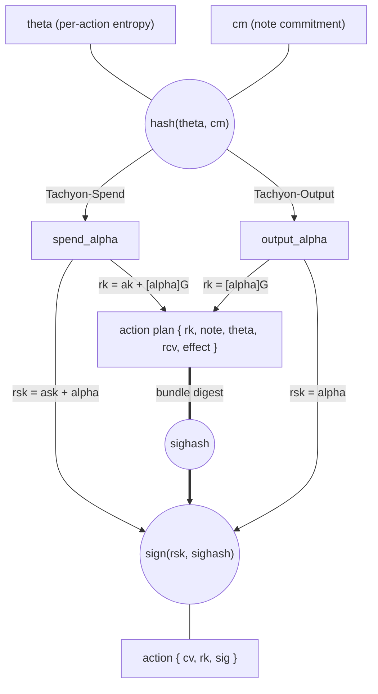
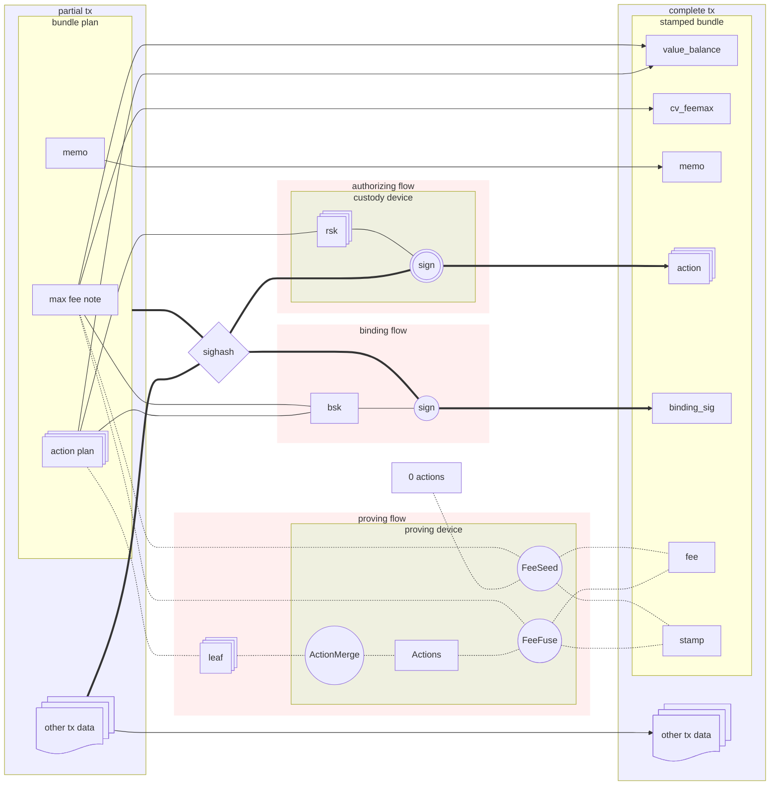

# Authorization

A Tachyon bundle requires three layers of authorization: per-action signatures that bind each tachyaction to its tachygram, value commitments that hide individual values while preserving their algebraic sum, and a binding signature that proves the declared balance is correct.
This chapter covers each layer, then shows the complete flow from action creation through consensus.

## Actions

Each tachyaction requires a fresh randomized key pair.

The planner begins authorization by selecting arbitrary `theta` and a relevant note for each action. The custody device is provided each note and `theta`, and computes from them rather than checking planned values: it derives `cm` from each note, `alpha` from `theta` and `cm`, and `rk` from `alpha`.

The arbitrary entropy `theta` which combines with note commitment `cm` to deterministically produce the randomizer `alpha`:

$$ \alpha_{\text{spend}} = \text{Poseidon}_\text{Tachyon-Spend}(\theta, \mathsf{cm}) $$
$$ \alpha_{\text{output}} = \text{Poseidon}_\text{Tachyon-Output}(\theta, \mathsf{cm}) $$

`theta` and the Poseidon output are elements of $\mathbb{F}_p$, and `alpha` is that output read as a scalar in $\mathbb{F}_q$, which is larger.

Actions are signed with a unique per-action `rsk` signing key.
Spends and outputs have different relationships between `alpha` and `rsk`, but in both cases,
the action's published `rk` validating key is the public counterpart of `rsk`.

$$ \mathsf{rk} = [\mathsf{rsk}]\,\mathcal{G} $$

### Spend

Derivation of spend `rsk` is rerandomization of spending authority `ask`:

$$ \mathsf{rsk} = \mathsf{ask} + \alpha $$
$$ \mathsf{rk} = [\mathsf{ask} + \alpha]\,\mathcal{G}$$

Conveniently, `rk` is also possible to derive from validating `ak`.
The rerandomization of a validating key is equivalent to derivation of a validating key from the rerandomized authority:

$$ \mathsf{rk} = \mathsf{ak} + [\alpha]\,\mathcal{G} $$

So during planning, the planning device obtains `rk` from the validating `ak`.
Then during authorization, the custody device is able to confirm correctness of `rk`, and sign the spend action with its private `rsk`.

### Output

An output `rsk` is simply equal to `alpha`. No authority needed:

$$ \mathsf{rsk} = \alpha $$
$$ \mathsf{rk} = [\alpha]\,\mathcal{G} $$

Then during authorization, the custody device is able to confirm correctness of `rk`, before signing any spends.

## Bundle commitment

The bundle commitment is a digest of the bundle's effect.

$$
\mathsf{hActionsTachyon} =
    \text{BLAKE2b-256}_\text{Tachyon-Actions}\bigl( \mathsf{cv}_i \| \mathsf{rk}_i \bigr)
$$

$$
\mathsf{hMemoTachyon} =
    \text{BLAKE2b-256}_\text{Tachyon-Memo}( \mathsf{vMemoTachyon} )
$$

$$
\text{BLAKE2b-256}_\text{ZTxIdTachyonHash}\bigl(
    \mathsf{hActionsTachyon} \| \mathsf{valueBalanceTachyon} \| \mathsf{cvFeeMaxTachyon} \| \mathsf{hMemoTachyon}
\bigr)
$$

The action digest hashes every action's $(\mathsf{cv}, \mathsf{rk})$ in wire order, so the commitment fixes the actions and their order. Hashing the memo to a fixed width is what lets the outer digest absorb a variable-length payload without a length prefix.

$\mathsf{cvFeeMaxTachyon}$ is the [max fee note](./fee.md)'s value commitment. The fee is authorization data and stays out of the bundle commitment.

The stamp proof binds the same actions by a different construction: a Pedersen commitment to the polynomial whose roots are the Poseidon action digests $d_i$ and the [fee digests](./fee.md#fee-change-note) $d_{\fee,j}$ of the covered bundles,

$$ d_i = \text{Poseidon}_\text{Tachyon-ActionDg}(\mathsf{cv}_i \| \mathsf{rk}_i) $$
$$ \mathsf{action\_acc} = \text{Commit}\Bigl(\prod_i \bigl(X - d_i\bigr) \prod_j \bigl(X - d_{\fee,j}\bigr)\Bigr) $$

which is order-independent, as a set commitment must be to survive [aggregation](./aggregation.md). The BLAKE2b digest and the action accumulator both fix the actions and are not interchangeable.

The stamp is excluded from the bundle commitment because it is stripped during aggregation.

### Transaction sighash

All signatures (action and binding) sign the same transaction-wide sighash.
The sighash is computed at the transaction layer, incorporating the bundle commitment from each pool (transparent, sapling, orchard, tachyon).
The tachyon crate contributes its bundle commitment; a transaction-level crate computes the sighash and passes it in as opaque bytes.

This binds every signature to the complete set of effecting data across all pools.
The stamp steps derive `alpha` in-circuit from the witnessed `theta` and the `cm` their left header certifies, so `rk` is itself a commitment to `cm`, and the signature transitively binds each action to its tachygram without the tachygram appearing in the action.

Tachyon also contributes to the transaction-level `auth_digest` that backs `wtxid`. See [Transaction Identifiers](./transaction-identifiers.md) for the formula and how aggregation changes the authorization form.

## Value Balance

Tachyon uses Pedersen commitments on the Pallas curve for value hiding:

$$\mathsf{cv} = [v]\,\mathcal{V} + [\mathsf{rcv}]\,\mathcal{R}$$

where $v$ is the signed integer value (positive for spends, negative for outputs) and `rcv` is a random[^rcv-note] trapdoor in $\mathbb{F}_q$.

[^rcv-note]: `rcv` is currently sampled as a uniformly random scalar (`Fq::random`). This derivation may be revised in the future to incorporate a hash of the note commitment or other action-specific data.

The generators $\mathcal{V}$ and $\mathcal{R}$ are shared with Orchard, derived from the domain `z.cash:Orchard-cv`.[^generator-todo]

[^generator-todo]: The binding signature scheme uses `reddsa::orchard::Binding` which hardcodes $\mathcal{R}$ as its basepoint. We should consider defining a unique personalization.

### Binding signature {#binding-signature}

The sum of value commitments preserves the algebraic structure:

$$\sum_i \mathsf{cv}_i = \bigl[\sum_i v_i\bigr]\,\mathcal{V} + \bigl[\sum_i \mathsf{rcv}_i\bigr]\,\mathcal{R}$$

This enables the binding signature scheme to prove value balance without revealing individual values.

The binding signature proves that the bundle's value commitments are consistent with the declared `value_balance`.

**Planner** knows every `rcv` and computes `bsk`:

$$\mathsf{bsk} = \sum_i \mathsf{rcv}_i$$

The planner signs the transaction sighash to produce `binding_sig` directly, without custody assistance.

**Validators** know the claimed `value_balance` and each published action `cv`. Validators reconstruct the corresponding public key:

$$\mathsf{bvk} = \sum_i \mathsf{cv}_i - [\mathsf{value\_balance}]\,\mathcal{V}$$

Expanding the commitments $\mathsf{cv}_i = [v_i]\,\mathcal{V} + [\mathsf{rcv}_i]\,\mathcal{R}$:

$$\mathsf{bvk} = \bigl[\sum_i v_i - \mathsf{value\_balance}\bigr]\,\mathcal{V} + \bigl[\sum_i \mathsf{rcv}_i\bigr]\,\mathcal{R}$$

When $\sum_i v_i = \mathsf{value\_balance}$, the $\mathcal{V}$ component vanishes:

$$\mathsf{bvk} = [\mathsf{bsk}]\,\mathcal{R}$$

If the values don't balance, the $\mathcal{V}$ term survives. So,

- If the sum of committed values doesn't truly equal the public balance, the signer cannot produce a valid signature.
- If a valid signature was produced and then the committed values or the public balance were modified, the validator can't confirm the valid signature.

Every bundle's [max fee note](./fee.md) adds its value commitment $\cv_\feemax = [-\feemax]\,\mathcal{V} + [r]\,\mathcal{R}$ as one more output-signed term. The planner adds $r$ to $\mathsf{bsk}$, and validators add $\cv_\feemax$ to $\mathsf{bvk}$:

$$\mathsf{bsk} = \boxplus_i \mathsf{rcv}_i \boxplus r$$

$$\mathsf{bvk} = \sum_i \mathsf{cv}_i + \cv_\feemax - [\mathsf{value\_balance}]\,\mathcal{V}$$

The fee does not enter $\mathsf{bvk}$. The binding signature is made once, before the fee is chosen.

## Simplified Flow

A bundle plan feeds three independent paths that converge in the final bundle.
Each path consumes the same action plans but produces a different component of the bundle:

- **Authorizing**: custody derives `rsk` per spend action and signs the transaction sighash; output actions are signed by the user device.
- **Binding**: the [bundle commitment](#bundle-commitment) feeds into the transaction sighash, which the binding key signs.
- **Proving**: each action plan yields `Actions`; leaves merge into one `Actions` PCD, and [$\mathsf{FeeFuse}$](./fee.md#fee-change-note) applies the fee to produce a stamp. A zero-action plan uses $\mathsf{FeeSeed}$.

Consensus recomputes the actions from the visible bundle and checks them against both the sighash (via the bundle commitment's ordered BLAKE2b digest) and the stamp (via the polynomial commitment in the PCD header).

A modified action breaks both checks.

## Detailed Sequence

The sequence follows `bundle::Plan` through signing, `stamp::Plan::prove` through stamping, and `Bundle::verify` through consensus.
Custody is drawn as a separate participant for a device-split integration that does not exist yet.
`Plan::sign` takes an opaque sighash and signs it; the recomputation and sighash confirmation shown under Custody are requirements on such an integration, not implemented API.
The spend lineage (`NoteSecret`, `NoteSpendable`, anchor spans) is built during wallet sync and is described in [Proof Tree](./proof-tree.md).
Diagram notes drop the `Tachyon-` prefix from Poseidon and BLAKE2b domain tags and use the Rust field names; `cTachygrams` is the wire name of `tachygram_set`.

The tachygram set commitment and stamp trailer fields below describe the design on `main` today; [#226](https://github.com/tachyon-zcash/tachyon/issues/226) may redesign them.

```mermaid
sequenceDiagram

actor User

activate User

    note over User: select/create notes { pk, v, psi, rcm }

rect rgb(100, 149, 237, 0.1)
    loop per action

        note over User: random theta
        note over User: random rcv
        note over User: cm = Poseidon_CmDerive(rcm, pk, v, psi)
        alt spend
            note over User: alpha = Poseidon_Spend(theta, cm)
            note over User: rk = ak + [alpha]G
            note over User: cv = Pedersen(v, rcv)
        else output
            note over User: alpha = Poseidon_Output(theta, cm)
            note over User: rk = [alpha]G
            note over User: cv = Pedersen(-v, rcv)
        end
        note over User: action_plan { rk, note, theta, rcv, effect }
    end

    note over User: max_fee_note { pk, feemax, psi, rcm }
    note over User: r = Poseidon_FeeBlind(pk, psi, rcm)
    note over User: cv_feemax = Pedersen(-feemax, r)
    note over User: value_balance = Sum v_spend - Sum v_output - feemax
    note over User: bundle_plan { spends[], outputs[], max_fee_note, memo }
    note over User: hActionsTachyon = Blake2b(cv_i || rk_i) over the sorted descriptor set, which is the wire order
    note over User: bundle_commitment = Blake2b(hActionsTachyon || value_balance || cv_feemax || hMemoTachyon)
    note over User: compute sighash
end

par Authorizing
    rect rgb(255, 165, 0, 0.1)

        create participant Custody

        User ->> Custody: bundle_plan, sighash

        loop per action
            note over Custody: cm = Poseidon_CmDerive(rcm, pk, v, psi)
            note over Custody: alpha = Poseidon_Spend(theta, cm) or Poseidon_Output(theta, cm)
            alt spend
                note over Custody: cv = Pedersen(v, rcv)
                note over Custody: rk = ak + [alpha]G
            else output
                note over Custody: cv = Pedersen(-v, rcv)
                note over Custody: rk = [alpha]G
            end
        end
        note over Custody: cv_feemax = Pedersen(-feemax, Poseidon_FeeBlind(pk, psi, rcm))
        note over Custody: hActionsTachyon = Blake2b(cv_i || rk_i)
        note over Custody: bundle_commitment = Blake2b(hActionsTachyon || value_balance || cv_feemax || hMemoTachyon)
        note over Custody: confirm sighash (custody requirement, not performed by Plan::sign)

        loop per spend action
            note over Custody: rsk = ask + alpha
            note over Custody: sig = Sign(rsk, sighash)
        end
        destroy Custody
        Custody -->> User: spend action_sigs

        loop per output action
            note over User: sig = Sign(alpha, sighash)
        end

        critical apply_signatures
            note over User: every planned descriptor (cv, rk) has exactly one signature
            note over User: bsk = Sum rcv_i + r
            note over User: binding_sig = Sign(bsk, sighash)
            note over User: bundle { actions[], value_balance, cv_feemax, binding_sig, memo } unproven
        end
    end

and Proving
    rect rgb(138, 43, 226, 0.1)
        note over User: select anchor
        note over User: stamp_plan { spends (desc, theta, rcv), outputs (desc, theta, note, rcv), anchor, max_fee_note, fee }

        create participant Stamper
        User ->> Stamper: stamp_plan, pak { ak, nk }, per spend (NoteSecret, NoteSpendable, anchor spans)

        loop per spend action
            note over Stamper: checked first, with spans the last must end at stamp_plan.anchor, without spans the spendable anchor must already equal it
            critical SpendBind(NoteSpendable, NoteSecret), witness rcv
                note over Stamper: spendable.cm == secret.cm
                note over Stamper: mk = Poseidon_NfMaster(psi, nk), carried by NoteSecret
                note over Stamper: nf_e = PRF(mk, e), nf_next = PRF(mk, e + 1)
                note over Stamper: cv = Pedersen(v, rcv)
                note over Stamper: SpendHeader (cm, nf_e, nf_next, anchor, pk, cv)
            end
            critical SpendAction(SpendHeader), witness theta, pak
                note over Stamper: pk == Poseidon_PkDerive(x(ak), y(ak), nk)
                note over Stamper: alpha = Poseidon_Spend(theta, cm)
                note over Stamper: rk = ak + [alpha]G
                note over Stamper: d = Poseidon_ActionDg(x(cv), y(cv), x(rk), y(rk))
                note over Stamper: Actions (Commit(X - d), Commit((X - nf_e)(X - nf_next)), anchor)
            end
            loop per supplied anchor span, possibly none
                note over Stamper: ActionLift, anchor is the span start or a member, becomes the span end
            end
        end

        loop per output action
            critical OutputBind, witness note, rcv
                note over Stamper: cm = Poseidon_CmDerive(rcm, pk, v, psi)
                note over Stamper: pad = Poseidon_CmOutPad(rcm, pk, v, psi)
                note over Stamper: cv = Pedersen(-v, rcv)
                note over Stamper: OutputHeader (cm, pad, cv)
            end
            critical OutputAction(OutputHeader), witness theta, anchor
                note over Stamper: alpha = Poseidon_Output(theta, cm)
                note over Stamper: rk = [alpha]G
                note over Stamper: d = Poseidon_ActionDg(x(cv), y(cv), x(rk), y(rk))
                note over Stamper: Actions (Commit(X - d), Commit((X - cm)(X - pad)), anchor)
            end
        end

        loop while Actions > 1
            critical ActionMerge(left, right)
                note over Stamper: left.anchor == right.anchor
                note over Stamper: merged_action = left.action_poly * right.action_poly
                note over Stamper: merged_tg = left.tg_poly * right.tg_poly
                note over Stamper: Actions (Commit(merged_action), Commit(merged_tg), anchor)
            end
        end

        note over Stamper: cv_feemax = Pedersen(-feemax, Poseidon_FeeBlind(pk, psi, rcm))
        alt no actions
            critical FeeSeed, witness max_fee_note, anchor
                note over Stamper: feemax == 0, so fee == 0
                note over Stamper: d_fee = Poseidon_FeeDg(x(cv_feemax), y(cv_feemax), 0)
                note over Stamper: cm_chg = Poseidon_CmDerive(rcm, pk, 0, psi)
                note over Stamper: Stamp (Commit(X - d_fee), Commit(X - cm_chg), anchor)
            end
        else
            critical FeeFuse(Actions), witness max_fee_note, fee
                note over Stamper: d_fee = Poseidon_FeeDg(x(cv_feemax), y(cv_feemax), fee)
                note over Stamper: cm_chg = Poseidon_CmDerive(rcm, pk, feemax - fee, psi)
                note over Stamper: fee_action = action_poly * (X - d_fee)
                note over Stamper: fee_tg = tg_poly * (X - cm_chg)
                note over Stamper: Stamp (Commit(fee_action), Commit(fee_tg), anchor)
            end
        end
        note over Stamper: rerandomize proof
        note over Stamper: hStampCoverageTachyon = Blake2b_Coverage(hStampActionsTachyon || hStampFeesTachyon)
        destroy Stamper
        Stamper ->> User: ProofStamp { fee, coverage, anchor, tachygram_set, tachygrams, proof }

        break
            note over User: rebuild header from own descriptors, fee descriptor and tachygrams, verify proof
        end
    end
end

create participant Consensus
note over User: transaction { actions[], value_balance, cv_feemax, binding_sig, memo, stamp { fee, coverage, anchor, tachygram_set, tachygrams, proof } }
deactivate User
destroy User
User ->> Consensus: transaction
break verify_signatures
    note over Consensus: hActionsTachyon = Blake2b(cv_i || rk_i)
    note over Consensus: bundle_commitment = Blake2b(hActionsTachyon || value_balance || cv_feemax || hMemoTachyon)
    note over Consensus: compute sighash
    note over Consensus: bvk = Sum cv_i + cv_feemax - [value_balance]V
    note over Consensus: check binding_sig against sighash under bvk
    note over Consensus: check each action sig against sighash under rk
end
break verify_pointers
    note over Consensus: the adjuncts come from the block, not the wallet
    note over Consensus: wtxid is nonzero and every adjunct points at it
end
break verify_coverage
    note over Consensus: no duplicate action descriptor, no duplicate fee descriptor across covered bundles
    note over Consensus: hStampCoverageTachyon == Blake2b_Coverage(hStampActionsTachyon || hStampFeesTachyon)
end
break verify_tachygrams
    note over Consensus: nTachygrams == 2N + B
    note over Consensus: cTachygrams == Commit(product over tachygrams of (X - tg))
end
break verify_proof
    note over Consensus: d_i = Poseidon_ActionDg(x(cv_i), y(cv_i), x(rk_i), y(rk_i))
    note over Consensus: d_fee_j = Poseidon_FeeDg(x(cv_feemax_j), y(cv_feemax_j), fee_j)
    note over Consensus: action_acc = Commit(product of (X - d_i) and (X - d_fee_j))
    note over Consensus: verify proof against Stamp (action_acc, cTachygrams, anchor)
end
```

