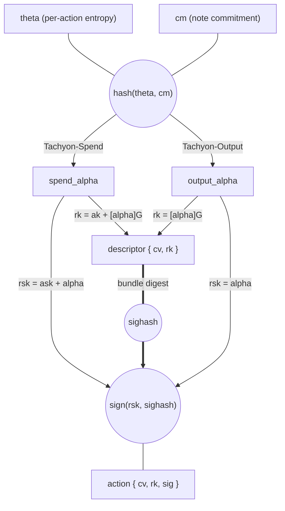
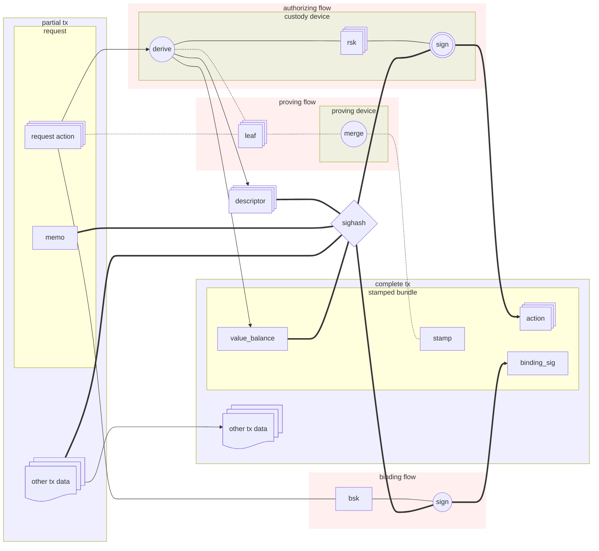
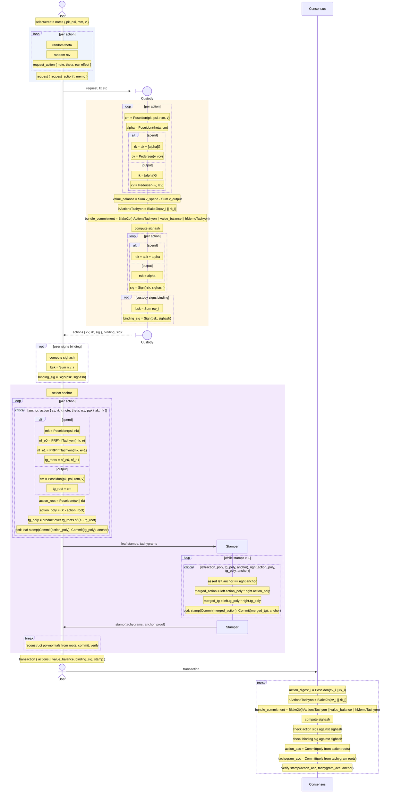

# Authorization

A Tachyon bundle requires three layers of authorization.
Per-action signatures bind each tachyaction to its tachygram, value commitments hide individual values while preserving their algebraic sum, and a binding signature proves the declared balance is correct.
This chapter covers each layer, then shows the complete flow from action creation through consensus.

## Actions

Each tachyaction requires a fresh randomized key pair.

The planner begins authorization by choosing a note, the action's entropy `theta` and a value commitment trapdoor `rcv` for each action. The custody device receives each note, `theta` and `rcv`. It derives `cm` from each note, `alpha` from `theta` and `cm`, `rk` from `alpha`, and `cv` from the note's value and `rcv`. Custody checks none of these against planned values.

The arbitrary entropy `theta` which combines with note commitment `cm` to deterministically produce the randomizer `alpha`:

$$ \alpha_{\text{spend}} = \text{Poseidon}_\text{Tachyon-Spend}(\theta, \mathsf{cm}) $$
$$ \alpha_{\text{output}} = \text{Poseidon}_\text{Tachyon-Output}(\theta, \mathsf{cm}) $$

`theta` and the Poseidon output are elements of $\mathbb{F}_p$, and `alpha` is that output read as a scalar in $\mathbb{F}_q$, which is larger.

Actions are signed with a unique per-action `rsk` signing key.
Spends and outputs have different relationships between `alpha` and `rsk`, but in both cases,
the action's published `rk` validating key is the public counterpart of `rsk`.

$$ \mathsf{rk} = [\mathsf{rsk}]\,\mathcal{G} $$

### Spend

Derivation of spend `rsk` is rerandomization of spending authority `ask`:

$$ \mathsf{rsk} = \mathsf{ask} + \alpha $$
$$ \mathsf{rk} = [\mathsf{ask} + \alpha]\,\mathcal{G}$$

Conveniently, `rk` is also possible to derive from validating `ak`.
The rerandomization of a validating key is equivalent to derivation of a validating key from the rerandomized authority:

$$ \mathsf{rk} = \mathsf{ak} + [\alpha]\,\mathcal{G} $$

A device that holds `ak` and `theta` therefore computes the same `rk` without `ask`.
The planner uses this to know each `rk`, and the sighash, before custody signs. The spend proof derives `rk` the same way.
Custody derives `rk` and signs the spend action with `rsk`.

### Output

An output `rsk` is simply equal to `alpha`. No authority needed:

$$ \mathsf{rsk} = \alpha $$
$$ \mathsf{rk} = [\alpha]\,\mathcal{G} $$

Custody derives `rk` and signs the output action with `rsk`.

## Bundle commitment

The bundle commitment is a digest of the bundle's effect.

$$
\mathsf{hActionsTachyon} =
    \text{BLAKE2b-256}_\text{Tachyon-Actions}\bigl( \mathsf{cv}_i \| \mathsf{rk}_i \bigr)
$$

$$
\mathsf{hMemoTachyon} =
    \text{BLAKE2b-256}_\text{Tachyon-Memo}( \mathsf{vMemoTachyon} )
$$

$$
\text{BLAKE2b-256}_\text{ZTxIdTachyonHash}\bigl(
    \mathsf{hActionsTachyon} \| \mathsf{valueBalanceTachyon} \| \mathsf{hMemoTachyon}
\bigr)
$$

The action digest hashes every action's $(\mathsf{cv}, \mathsf{rk})$ in wire order, so the commitment fixes the actions and their order. Hashing the memo to a fixed width is what lets the outer digest absorb a variable-length payload without a length prefix.

The stamp proof binds the same action set by a different construction.
It uses a Pedersen commitment to the polynomial whose roots are the Poseidon action digests,

$$ d_i = \text{Poseidon}_\text{Tachyon-ActionDg}(\mathsf{cv}_i \| \mathsf{rk}_i) $$
$$ \mathsf{action\_acc} = \text{Commit}\Bigl(\prod_i \bigl(X - d_i\bigr)\Bigr) $$

which is order-independent, as a set commitment must be to survive [aggregation](./aggregation.md). The two digests are computed over the same actions and are not interchangeable.

The stamp is excluded from the bundle commitment because it is stripped during aggregation.

### Transaction sighash

All signatures (action and binding) sign the same transaction-wide sighash.
The sighash is computed at the transaction layer, incorporating the bundle commitment from each pool (transparent, sapling, orchard, tachyon).
The tachyon crate contributes its bundle commitment.
A transaction-level crate computes the sighash and passes it in as opaque bytes.

This binds every signature to the complete set of effecting data across all pools.
The stamp steps derive `alpha` in-circuit from the witnessed `theta` and the `cm` their left header certifies, so `rk` is itself a commitment to `cm`, and the signature transitively binds each action to its tachygram without the tachygram appearing in the action.

Tachyon also contributes to the transaction-level `auth_digest` that backs `wtxid`. See [Transaction Identifiers](./transaction-identifiers.md) for the formula and how aggregation changes the authorization form.

## Value Balance

Tachyon uses Pedersen commitments on the Pallas curve for value hiding:

$$\mathsf{cv} = [v]\,\mathcal{V} + [\mathsf{rcv}]\,\mathcal{R}$$

where $v$ is the signed integer value (positive for spends, negative for outputs) and `rcv` is a random[^rcv-note] trapdoor in $\mathbb{F}_q$.

[^rcv-note]: `rcv` is currently sampled as a uniformly random scalar (`Fq::random`). This derivation may be revised in the future to incorporate a hash of the note commitment or other action-specific data.

The generators $\mathcal{V}$ and $\mathcal{R}$ are shared with Orchard, derived from the domain `z.cash:Orchard-cv`.[^generator-todo]

[^generator-todo]: The binding signature scheme uses `reddsa::orchard::Binding` which hardcodes $\mathcal{R}$ as its basepoint. We should consider defining a unique personalization.

### Binding signature

The sum of value commitments preserves the algebraic structure:

$$\sum_i \mathsf{cv}_i = \bigl[\sum_i v_i\bigr]\,\mathcal{V} + \bigl[\sum_i \mathsf{rcv}_i\bigr]\,\mathcal{R}$$

This enables the binding signature scheme to prove value balance without revealing individual values.

The binding signature proves that the bundle's value commitments are consistent with the declared `value_balance`.

**Signer** holds every `rcv` and computes `bsk`:

$$\mathsf{bsk} = \sum_i \mathsf{rcv}_i$$

The planner chose every `rcv` and sent each one to custody, so either device can sign.
Custody may sign `binding_sig` in the same exchange as the actions.
Otherwise the planner signs it, before or after custody answers.

**Validators** know the claimed `value_balance` and each published action `cv`. Validators reconstruct the corresponding public key:

$$\mathsf{bvk} = \sum_i \mathsf{cv}_i - [\mathsf{value\_balance}]\,\mathcal{V}$$

Expanding the commitments $\mathsf{cv}_i = [v_i]\,\mathcal{V} + [\mathsf{rcv}_i]\,\mathcal{R}$:

$$\mathsf{bvk} = \bigl[\sum_i v_i - \mathsf{value\_balance}\bigr]\,\mathcal{V} + \bigl[\sum_i \mathsf{rcv}_i\bigr]\,\mathcal{R}$$

When $\sum_i v_i = \mathsf{value\_balance}$, the $\mathcal{V}$ component vanishes:

$$\mathsf{bvk} = [\mathsf{bsk}]\,\mathcal{R}$$

If the values don't balance, the $\mathcal{V}$ term survives. So,

- If the sum of committed values doesn't truly equal the public balance, the signer cannot produce a valid signature.
- If a valid signature was produced and then the committed values or the public balance were modified, the validator can't confirm the valid signature.

## Simplified Flow

A request feeds three paths that converge in the final bundle.
Each path produces a different component of the bundle:

- **Authorizing**: custody derives each action's `rk` and `cv`, and signs every action over the transaction sighash.
- **Binding**: the bundle commitment (from the action descriptors, `value_balance` and the memo) feeds the transaction sighash, which the binding key signs. Custody or the planner holds the binding key.
- **Proving**: each action yields a leaf stamp from its note, `theta` and `rcv`, and the leaves merge into a single Ragu PCD stamp. Proving needs nothing from custody.

Consensus recomputes the actions from the visible bundle and checks them against both the sighash (via the bundle commitment's ordered BLAKE2b digest) and the stamp (via the polynomial commitment in the PCD header).

A modified action breaks both checks.

## Detailed Sequence

The user sends one request to custody.
Custody derives every value it signs and validates nothing.

## Signing outside custody

Some signers return only signatures.
A FROST group and a hardware device that never sees the notes are two examples.
For these, the planner derives each action's `rk` from `ak` and `theta`, and `cv` from `rcv`.
It computes the bundle commitment and the sighash, and sends the descriptors and the sighash to the signers.
The signers return one signature for each action.
The planner attaches them to the descriptors it derived and signs the binding signature itself.
A signed descriptor that differs from a derived one is rejected.
