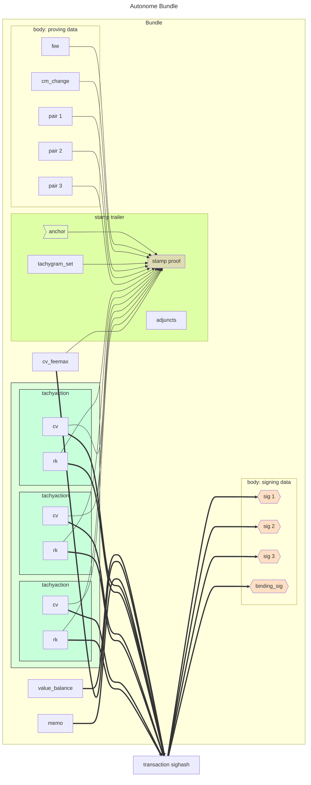

# Bundles

This document describes the structure of Tachyon shielded bundles.

## Brief

Users create transactions with a bundle of Tachyon shielded data including a Ragu[^ragu] proof.
These transactions are broadcast to the p2p network.

Before block inclusion, Tachyon shielded data is recursively 'aggregated' in a compact format that ultimately reduces the operational burdens and improves the user experience of the chain.

## Concepts

### Tachygrams

**Tachygrams** are 32-byte field elements representing either nullifiers or note commitments. The consensus protocol does not need to distinguish between nullifiers and note commitments, and treats them identically.[^tachygram]

[^tachygram]: See [Tachyaction at a Distance](https://seanbowe.com/blog/tachyaction-at-a-distance/) for the design rationale behind unified tachyactions and tachygrams.
[^ragu]: See the Ragu [book](https://tachyon.z.cash/ragu/).
[^redpallas]: See [RedDSA](https://zips.z.cash/protocol/protocol.pdf#concretereddsa) in the Zcash Protocol Specification.

### Tachyactions

Each **tachyaction** indistinguishably represents either the creation or destruction of a note.

- A tachyaction with a commitment tachygram proves a note is created.
- A tachyaction with a nullifier tachygram proves a note is destroyed.

Each tachyaction is cryptographically bound to a pair of tachygrams. The pair is in the bundle body's `vActionTachygramsTachyon`, at the action's position.

Each tachyaction contains:

- `cv` - a 32-byte homomorphic commitment to the note's created or destroyed value
- `rk` - a 32-byte randomized public key
- `sig` - a 64-byte RedPallas[^redpallas] signature by `rk` over the transaction sighash

The action digest binds `cv`, `rk`, and the pair through its sum and product. The signature signs the effecting descriptor `(cv, rk)` through the transaction sighash; the pair is authorization data. The wire separates descriptors, signatures, and pairs into effecting, signing, and proving sections of the body.

### Tachystamp

The **tachystamp** carries a recursive stamp proof that all covered tachyactions and fees follow the protocol rules. Each released stamp proof is [rerandomized](./proof-tree.md#rerandomization-at-trust-boundaries), though Ragu does not yet provide zero knowledge for either stamp proof form.

It contains:

- `anchor` - a chain [anchor](./anchor.md)
- `tachygram_set` - a commitment to the union of the covered actions' pairs and covered bundles' fee change note commitments
- `adjuncts` - the txids of the other transactions whose bundles the proof covers, empty for an autonome
- `proof` - the recursive proof (which may be aggregated)

The proof establishes:

- tachygrams either create a new note or destroy an existing note
- tachygrams are correctly bound to action keys
- each `cv` commits to the value of the note its tachygrams belong to
- the fee change note commits to $\feemax - \fee$, with the fee at most the signed maximum

Pool balance is not a statement of the proof. The value balance never enters a circuit; the [binding signature](./authorization.md#binding-signature) enforces it over the published `cv` values.

The nullifier for epoch $e$ is a pseudo-random function of the note's master key and the epoch:

$$ \mathsf{nf}_e = \mathsf{PRF}^{\mathsf{nfTachyon}}_{\mathsf{mk}}(e) $$

where

- $\mathsf{mk} = \mathsf{Poseidon}_\texttt{Tachyon-NfMaster}\!(\psi, \mathsf{nk})$ is the note's master key, seeded by the trapdoor $\psi$ committed in the $\psi$ field[^commitment]
- $\mathsf{PRF}^{\mathsf{nfTachyon}}$ is the [nullifier PRF](./nullifiers.md)
- $e$ is an epoch index

[^commitment]: User-controlled randomness [commitment trapdoor](https://zips.z.cash/protocol/protocol.pdf#commitment)

## Bundle Structure

A Tachyon bundle collects tachyactions with authorization data:

- `actions` - the effecting action descriptors `(cv, rk)`
- `action_auth` - one `(signature, tachygram pair)` tuple per action, in the same order
- `value_balance` - integer net pool effect, with the max fee note counted as an output
- `cv_feemax` - the [max fee note](./fee.md)'s value commitment
- `fee` - the fee chosen at or below the signed maximum
- `cm_change` - the fee change note commitment
- `binding_sig` - signature over the transaction sighash (same digest as action sigs)
- `memo` - opaque recipient-directed payload, empty when absent
- `stamp` - anchor, tachygram set commitment, adjunct txids, and stamp proof; stripping replaces these with the fieldless `StrippedStamp`

## Lifecycle

Signing a `bundle::Plan` returns a descriptor-keyed action signature map and the binding signature. Independently, `stamp::Plan::prove` returns the proof stamp, a descriptor-keyed map of tachygram pairs, the change commitment, and the chosen fee.

`bundle::Plan::assemble(signatures, proof)` combines their outputs with the plan. It requires the plan, pair map, and signature map to have identical descriptor keys and panics if they differ. It joins both maps in descriptor order into `actions` and `action_auth` and attaches the fee, change, and stamp. This checks keys, not pair values or proof validity. Signing and proving may run in either order or concurrently.

Users create transactions containing their individual actions and individual stamp, known as **autonomes**. These are broadcast to the p2p network. Before block inclusion, aggregators strip and merge stamps from selected transactions, producing **aggregates** (transactions carrying merged stamps) and **adjuncts** (transactions stripped of their stamp).

See [Aggregation](./aggregation.md) for transaction categories, block layout, and validation.

## Wire Format

The first byte `tachyonBundleState` selects one of three bundle states:

| value | state | bundle contents |
| --- | --- | --- |
| `0b0000_0000` | non-tachyon | no bundle |
| `0b0000_0001` | stamped (`ProofStamp`) | bundle with tachygrams, fee, fee change, anchor, tachygram set commitment, adjunct txids, proof |
| `0b0000_0010` | stripped (`StrippedStamp`) | bundle with tachygrams, fee and fee change |

### Bundle body {#bundle-body}

When `tachyonBundleState` is not `0x00`, the state byte is followed by the bundle body, which is the same in both remaining states:

| Section | Name | Format | Description |
| --- | --- | --- | --- |
| effecting | `valueBalanceTachyon` | i64 LE | net value of tachyon actions, with the max fee note counted as an output; range-checked and zero for no actions |
| | `nActionsTachyon` | compactSize | number of tachyon actions |
| | `vActionsTachyon` | 64 * nActionsTachyon | canonical `cv` (32 bytes), `rk` (32 bytes) |
| | `cvFeeMaxTachyon` | 32 bytes | [max fee note](./fee.md) value commitment |
| | `nMemoTachyon` | compactSize | memo length, `0` when absent |
| | `vMemoTachyon` | nMemoTachyon bytes | opaque recipient-directed payload |
| signing | `vActionSigsTachyon` | 64 * nActionsTachyon | authorization per action over the tx sighash |
| | `bindingSigTachyon` | 64 bytes | binding signature over the tx sighash |
| proving | `vActionTachygramsTachyon` | 64 * nActionsTachyon | two canonical field elements per action, in action order |
| | `vFeeTachyon` | LE64 | fee, at most `MAX_MONEY` |
| | `cmChangeTachyon` | 32 bytes | canonical field element, the fee change note commitment |

A single `nActionsTachyon` frames all three action vectors; there are no additional vector counts. `cvFeeMaxTachyon` is effecting data and must be a canonical encoding of a non-identity point. The bundle contributes `valueBalanceTachyon + vFeeTachyon` to the transaction balance.

`nActionsTachyon` is at most 4095, the most actions whose pairs fit one set polynomial beside the bundle's fee change. Parsing rejects a larger count.

The prover writes each pair smaller tachygram first, so the order reveals neither member's role. The encoding accepts either order, and [`tachyon_auth_digest`](./transaction-identifiers.md) hashes each pair as written. Parsing rejects any repeated member among the action pairs and `cmChangeTachyon`, in either bundle state.

The memo is effecting data, so the transaction sighash covers it and `auth_digest` does not. A relayer rewrites `auth_digest` while aggregating, so a memo held there could be stripped while the block still committed to the same transaction.

`nMemoTachyon` is public, and `0` reveals that no payload is present. The field is variable-length because Tachyon has no per-action ciphertext to hide a memo inside: an action is `(cv, rk)`, 64 bytes. The payload is also bimodal, carrying key-exchange ciphertexts on first contact and ordinary memo text otherwise, at sizes differing by more than an order of magnitude. A fixed field would have to be sized for the first-contact case and charged on every transaction.

### Stamp trailer {#stamp-trailer}

When `tachyonBundleState == 0x01`, the bundle body is followed by a stamp trailer:

| Name | Format | Description |
| --- | --- | --- |
| `anchorTachyon` | 32 bytes | pool state reference |
| `cTachygrams` | 32 bytes | commitment to the tachygram union derived from covered bundles |
| `nAdjunctsTachyon` | compactSize | number of other covered transactions, `0` for an autonome |
| `vAdjunctsTachyon` | 32 * nAdjunctsTachyon | txids of the other covered transactions, strictly ascending |
| `sizeProofTachyon` | compactSize | length of `proofTachyon` in bytes |
| `proofTachyon` | `byte[sizeProofTachyon]` | the [Ragu stamp proof](./proof-tree.md#stamp-construction) |

`cTachygrams` is carried rather than derived, so full validation recomputes it from every covered bundle's `vActionTachygramsTachyon` and `cmChangeTachyon` and rejects a mismatch. Parsing rejects the identity point. Anchor advancement then absorbs the carried point instead of rebuilding it, which is what lets a validator extend the chain without touching the tachygrams again.

Every action contributes exactly two tachygrams, and every covered bundle's fee descriptor one fee change note commitment. A stamp covering $N$ actions in $B$ bundles therefore commits to $2N + B$ tachygrams, at most $2^{13} - 1$, because a set polynomial with $n$ roots has $n + 1$ coefficients and Ragu's production rank gives $2^{13}$. Full validation rejects a larger or repeating union.

A spend publishes its present and next nullifier; an output publishes its note commitment and a padding tachygram. Uniform arity is what keeps the two action kinds indistinguishable in the published set. A max fee note publishes its fee change note's commitment.

`vAdjunctsTachyon` lists the txid of every other transaction whose bundle the stamp proof covers. Those transactions are still stamped in the mempool and stripped in a block. The carrying bundle is never listed. Parsing rejects a list that is not strictly ascending by bytewise comparison, which also rejects a repeated txid. The list is a set, and one wire order lets a stamp read from the wire digest the same as the bytes received.

Every listed transaction's bundle holds at least its fee change in the tachygram union. A standalone stamp reader rejects $\mathsf{nAdjunctsTachyon} + 1 > 8191$ before reading the list. After reading the whole trailer, a proof-stamped bundle reader also rejects $2 \cdot \mathsf{nActionsTachyon} + \mathsf{nAdjunctsTachyon} + 1 > 8191$, because such a bundle can never verify.

Neither the stamp proof nor a signature binds the list. It enters [$\mathsf{hStampTachyon}$](./transaction-identifiers.md) directly, followed by the proof digest. Merging lists the txid of the one transaction the absorbed stamp covers without listing, and unmerging removes the divisor's. See [Aggregation → Adjunct list](./aggregation.md#adjunct-list).

The reader rejects a size above Ragu's transport bound before buffering `sizeProofTachyon` bytes for `proofTachyon`. Ragu's decoder validates the envelope and exact length of that frame.

Consensus carries `Compressed` proofs in [block items](./aggregation.md), and `Uncompressed` proofs use the same `tachyonBundleState == 0x01` layout while stamps are [merged](./aggregation.md#merge-to-produce-aggregate) and [lifted](./proof-tree.md#stamp-anchor) outside consensus.

[`hStampProofTachyon`](./transaction-identifiers.md) covers the stamp proof, the anchor and the tachygram set commitment. A verifier rebuilds the stamp proof's header from the last two. The stamp proof enters as its Ragu-encoded bytes, including the envelope. Its definition is the same for both proof forms.

### Stripped trailer

When `tachyonBundleState == 0x02`, the trailer is empty. Stripping replaces only the stamp, leaving the entire body, including action pairs, fee, and change, unchanged.

A stripped bundle holds no reference to the aggregate that covers it. That aggregate lists the stripped bundle's txid in its `vAdjunctsTachyon`.
