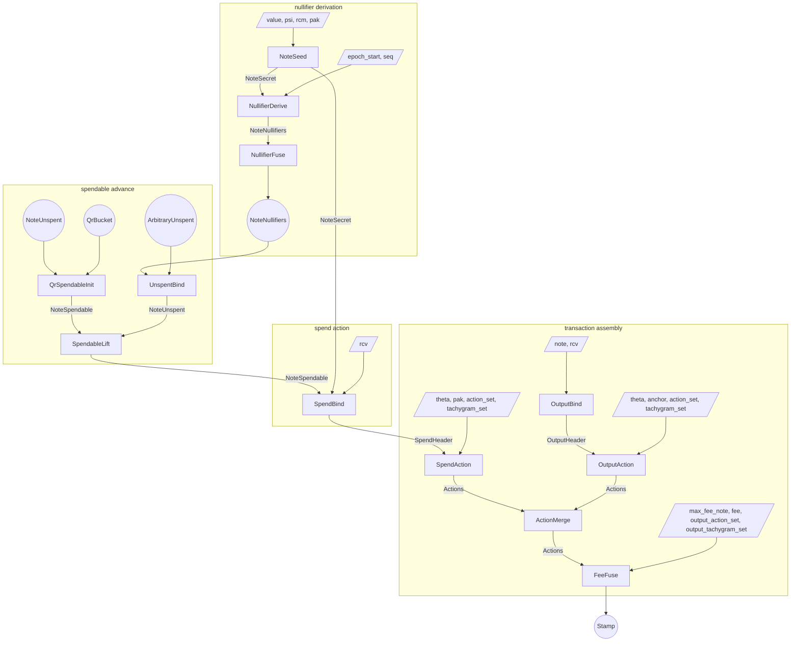
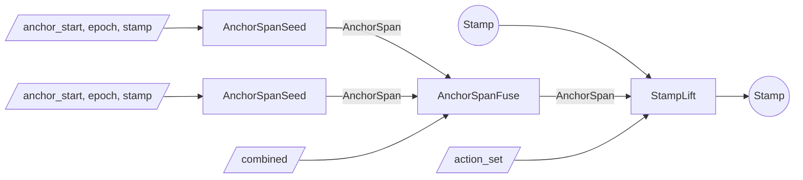
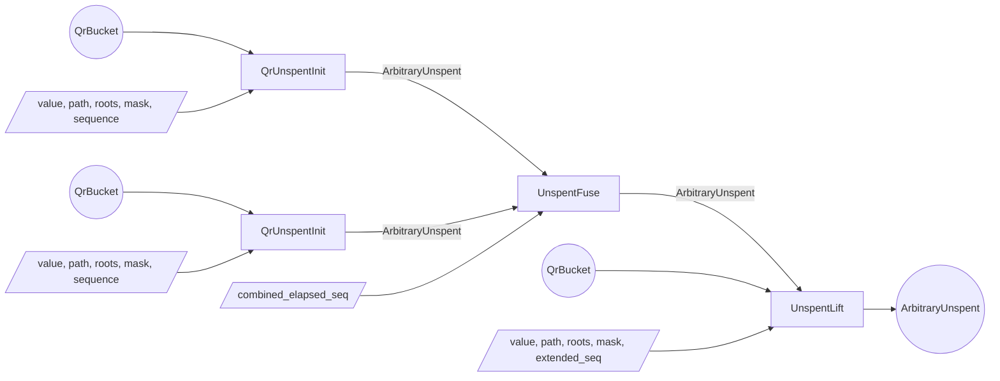

# Proof tree

The Tachyon proof tree is a graph of proof steps.
Each step accepts arbitrary witness inputs and up to two PCD inputs, performs computations and checks constraints, and emits a new PCD.

Multiple parties execute the proof tree.

- A **wallet** holds note data and keys
- A **sync service** holds nullifier values shared by the wallet and pool state proofs
- An **aggregator** merges stamps for pool efficiency

## Lifecycle

### Deriving nullifiers

A wallet proves a window of its note's nullifiers were correctly derived[^nullifiers].
`NoteSeed` witnesses the note's value and trapdoors and the proof-authorizing key `pak`. It derives the note's payment key `pk` from `pak`, the master key `mk` from `psi` and `nk`, and `cm` from the note with that `pk`, and emits a `NoteSecret` carrying `(cm, note, mk)`. `nk` never leaves the step.
`NullifierDerive` consumes that seed. It witnesses the window's start epoch, staged and required group-aligned with the window's last epoch at most `EPOCH_MAX`, and the window's sequence as its `NfSeqPoly`.
It runs four $\texttt{Tachyon-NfDerive}$ sponges, one per group, to squeeze the window's 16 nullifiers in the circuit, and checks with one opening at $\zeta$ that the sequence $g$ is the product of their indexed factors[^nullifiers]

$$g(\zeta) = \prod_{j < 16} F_{e_0 + j,\ \mathsf{nf}_{e_0 + j}}(\zeta)$$

for $e_0$ the start epoch. It exports the whole window, so the range it announces is derived rather than witnessed.
`NullifierFuse` concatenates two adjacent nullifier sequences into one, requiring the same `cm` and contiguity (`right.epoch_start == left.epoch_end + 1`). It checks at $\zeta$ that its output `NfSeqPoly` is the product of its inputs'.
The result is a `NoteNullifiers` proving the range `[epoch_start, epoch_end]` commits to the genuine nullifiers of the note identified by `cm`, one factor per covered epoch.

### Bootstrapping a spendable

A spendable starts when `SpendableInit` consumes a `NoteNullifiers`.
It witnesses `(anchor_prev, creation_set, creation_epoch)` with the creation set as its `TachygramSetPoly`. It takes `cm` from the range header, opens that polynomial at `cm` for zero, so `cm` is a root of it[^tachygrams], and emits a `NoteSpendable` carrying `(cm, creation_epoch, anchor)`.
Its anchor, the position immediately after the creation stamp, is $\mathsf{Poseidon}_\texttt{Tachyon-AnchorSt}(\mathsf{anchor\_prev}, \mathsf{creation\_epoch}, x(B), y(B))$ for $B$ the bridge hash of the creation set.
`anchor_prev` and `creation_epoch` are the prover's choice, and the step tests no exclusion.
The documentation of `NoteSpendable` in the crate says what this spendable asserts.

### Maintaining a spendable

A spendable from `SpendableInit` spends within its creation epoch. Carrying a note into later epochs means advancing its anchor forward over `ArbitraryUnspent` segments while proving the crossed nullifiers absent.
The sync service produces `ArbitraryUnspent` segments without ever holding the note, its `cm`, or `psi`: the values a segment tests are arbitrary field elements as far as its own proof is concerned, and only `UnspentBind` attributes them to a derivation.

A `Summary` folds a run of one epoch's stamps into one accumulator alongside the anchor (`SummarySeed`, `SummaryAdvance`); summaries are note-independent, so anyone can build them.
`SummarySeed` takes a predecessor anchor, an epoch and one stamp's tachygram set from its prover.
It places the set in both of its slots, `ACCUMULATED` and `LAST_STAMP`, and its `anchor_end` is the stamp absorption of the epoch and the set's bridge hash into the predecessor.
`SummaryAdvance` takes the next stamp's set as its `LAST_STAMP`, checks at $\zeta$ that its `ACCUMULATED` is the input's `ACCUMULATED` times that set, and absorbs the set's bridge hash to advance `anchor_end`.
Both require the set's opening at $\zeta$ to differ from one, which rejects the empty set.
The prover chooses where a summary starts and stops.
No step joins two summaries.
Each enters routing through `QrSummaryIntake`, and `QrIntakeMerge` joins the intakes when the first's `anchor_end` is the second's `anchor_prev`.
Summaries and single stamps root an epoch's QR evidence.
Once per epoch a builder routes every published tachygram into buckets by quadratic-residue profile (`QrSummaryIntake`, `QrStampIntakeSeed`, `QrEmptyIntakeSeed`, `QrIntakeSplit`, `QrSideSelect`, `QrSideDescend`, `QrIntakeMerge`, `QrBucketSeal`).
A value is in one class at each depth.
`QrUnspentInit` tests a value against a bucket of its class by opening the bucket's contents at the value for a nonzero result. The documentation of `QrBucket` in the crate says what that shows.
Every `ArbitraryUnspent` starts that way and covers whole epochs, half-open: `[anchor_start, anchor_next)` and `[epoch_start, epoch_next)`.
Both anchor bounds are boundary digests, and on the accepted chain they are the entry anchors of `epoch_start` and `epoch_next`.
An entry anchor belongs to the epoch it opens, so `anchor_next` belongs to `epoch_next` and is excluded.
A segment's `elapsed` holds one member per epoch in `[epoch_start, epoch_next)`; `epoch_next`'s nullifier is the next segment's to test.
`UnspentFuse` composes two segments meeting on one boundary (`left.anchor_next == right.anchor_start`, `left.epoch_next == right.epoch_start`), and its output `elapsed` is the product of the two inputs'.
`UnspentLift` appends one epoch in one step.
Its bucket starts on the segment's excluded bound (`unspent.anchor_next == bucket.anchor_start`, `unspent.epoch_next == bucket.epoch`), it tests a value against that bucket as `QrUnspentInit` does, and it multiplies the value's factor at the bucket's epoch into `elapsed`.
An epoch that published nothing seals an empty bucket, so its segment is as cheap as any other.
`QrSpendableInit` starts a wallet's spendable from the bucket holding its note's creation, over the note's own QR segment for that epoch.
A builder that keeps an epoch's buckets folds them into one `EvidenceTree` and retains a single proof for its root, replaying a bucket on demand from a quaternary Merkle path (`EvidenceTreeLeafPair`, `EvidenceTreePairFuse`, `EvidenceTreeFuse`, `EvidenceTreeCap`, `EvidenceTreeDescend`, `EvidenceTreeOpen`).
The evidence is note-independent and rebuildable from public data alone.

`UnspentBind` is wallet-side. It consumes the sync-built `ArbitraryUnspent` and a `NoteNullifiers`, and divides `elapsed` out of the derivation's sequence, so every factor of `elapsed` is a genuine nullifier of the note at its own epoch.
It takes the complement from its prover as its own `NfSeqPoly` and checks at $\zeta$ that the derivation's sequence $g$ factors as

$$g(X) = \mathsf{elapsed}(X) \cdot \mathsf{complement}(X)$$

The complement holds the derivation's factors outside the span, and the step compares no epoch bounds between its inputs.
It emits a `NoteUnspent` carrying the span's anchors and epochs, and the note's `cm`.

`SpendableLift` is wallet-side and witness-free: it consumes a `NoteSpendable` and a `NoteUnspent`.
It checks the verified segment's `cm` equals the spendable's (so the absence-proven nullifiers are this note's, and the value cannot drift), the segment's `epoch_start` equals the spendable's `epoch_current` (continuity), and the segment's `anchor_start` equals the spendable's anchor (adjacency).
It advances to the segment's `epoch_next` and `anchor_next`, threading `cm` unchanged.
A single lift can consume an arbitrarily long composed `ArbitraryUnspent`, including one that crosses many epoch boundaries.
Every segment opens on a boundary digest, so only a spendable that rests on one lifts.
That is a spendable from `QrSpendableInit` or one already lifted.

### Spending

To spend, the wallet runs `SpendBind`.
It consumes the `NoteSpendable` and the note's `NoteSecret`, and requires `secret.cm == spendable.cm`.
It derives the pair `(nf_current, nf_next)` from the secret's `mk`, at the lineage's epoch and the epoch after it, and commits the note's value as `cv` under the witnessed value-randomness.
It holds both nullifiers nonzero, and it has no assignment at the final epoch, which has no epoch after it.
The output `SpendHeader` carries `cm`, the derived pair `(nf_current, nf_next)`, the threaded anchor, the note's payment key `pk`, and `cv`.

Beside the stamp proof, nothing a spend publishes depends on the note's age.
Of the note's history the spendable carries only its current epoch, with no nullifier and no polynomial that records the epochs it has crossed, and the published pair sits at that epoch and the one after.
No step from `SpendBind` on reads how long the note has existed.

`SpendAction` consumes that `SpendHeader`, witnessing the action entropy `theta` and the proof authorizing key.
It requires the key to derive the header's `pk`, so the randomized action key `rk` belongs to the lineage's note, whose minted value `cv` commits to[^notes].
It derives the action randomizer `alpha` from `theta` and `cm`, then the action digest from `cv`, `rk`, and the nullifier pair's sum and product, and emits `Actions` whose tachygram set contains those same nullifiers and whose anchor is threaded from the spend.

An output operation also takes two steps, `OutputBind` and `OutputAction`.
`OutputBind` witnesses the new note and derives its tachygram pair, the note commitment `cm` and the padding tachygram `pad`, both from the same note fields[^tachygrams]; the resulting `OutputHeader` carries the pair and the value commitment `cv`.
`OutputAction` derives `alpha` from the witnessed `theta` and `cm`, binds `cv`, `rk`, and the pair's sum and product in the action digest, adds an anchor, and emits single-action `Actions` whose tachygram set is that same pair. The wallet typically anchors each output at the same height as the transaction's spends so the merge can proceed without an intervening lift.

A transaction with multiple spend and output actions composes them with `ActionMerge`.
The output is `Actions` whose multisets are the union of the two inputs' at the shared anchor.
If a spend's lineage is at an earlier anchor of the same epoch, the wallet first runs `ActionLift` along one or more `AnchorSpan`s to move the actions to the transaction's anchor.
After the merges, `FeeFuse` applies the bundle's fee to those actions, adding the fee digest to the action set and the [fee change note](./fee.md#fee-change-note) commitment to the tachygram set, and emits a `Stamp`.
A bundle with no actions uses `FeeSeed` instead.

After the transaction stamp is composed, the wallet may run `StampLift` along more spans to move the stamp's anchor closer to the chain's latest anchor before publication.
An `AnchorSpan` commits to every anchor produced inside it.
`AnchorSpanSeed` takes a predecessor anchor, an epoch and one stamp's tachygram set from its prover, and absorbs the epoch and the set's bridge hash into the predecessor.
The resulting anchor is the span's `anchor_end` and the only root of its members polynomial.
The seed requires the set's opening at $\zeta$ to differ from one, which rejects the empty set.
`AnchorSpanFuse` requires the left span's `anchor_end` to equal the right span's `anchor_start`, and checks that the combined members polynomial is the product of the two.
`StampLift` moves a stamp from the span's start, or from any of those anchors, to the span's end.
With $M$ for the members polynomial and $a$ for the anchor they move, `ActionLift` and `StampLift` check

$$M(a) \cdot (a - \mathsf{anchor\_start}) = 0$$

and output `anchor_end`.
The members polynomial does not record the order of its roots, so a lift always moves to the span's end.
`StampLift` takes its output action set from its prover and checks at $\zeta$ that it equals the input stamp's.
Consensus and sync services publish spans as an epoch progresses.
A wallet lifts its stamp along the published spans to the end of the latest one.
For the stamps published after that, it builds its own span.

On publication the bundle carries each action's descriptor and tachygram pair, the fee descriptor including its fee change, the anchor, and the stamp proof.
Validators reconstruct the action-set and tachygram-set commitments from those published bundles, check the proof against the reconstructed values, and confirm the anchor against the consensus chain.

After publication, an aggregator combines `Stamp`s from independently-proven bundles into a single **aggregate**[^aggregation] whose proof can stand in for many transactions' worth of stamps, cutting per-transaction verification cost downstream.
Each input is anchored at the height its wallet chose.
The aggregator runs `StampLift` on each input, along spans that contain that input's anchor, to move every input to the same later anchor.
`StampMerge` then fuses the aligned stamps pairwise into a single `Stamp` whose multisets are the union of all the inputs'.
The merged stamp stays with one receiving bundle and keeps that bundle's fee and fee change, and the receiver's stamp lists by `txid` the other transactions it covers, which a block holds stripped.
An innocent aggregate is itself a bundle with its own max fee note, so the aggregator proves its zero fee with `FeeSeed` and merges that stamp with the aligned stamps.
`StampUnmerge` divides one stamp by another at the same anchor, removing the divisor's leaves from the dividend.
Used to undo a merge, it leaves a quotient that stays with the dividend's bundle and keeps that bundle's fee and fee change.
An aggregator uses it when a block includes some of its contributors while the aggregate is still being built: it divides the aggregate by the included contributors' stamps and keeps building from the quotient.
The aggregated stamp has the same shape as any other, so it is itself eligible for further aggregation; aggregators stack to fold many published transactions into one stamp, and miners typically integrate the aggregator role into block production.

### Fee states and flows

`Actions` and `Stamp` are separate headers, distinguished by suffix, so the pre-fee and post-fee states are proof-enforced.
`Actions` carries only its anchor. `Stamp` carries `(tachygram_set_bridge, anchor)`, where `tachygram_set_bridge` is the bridge hash of the tachygram set.
Both hold the action set as an `ActionSetPoly` and the tachygram set as a `TachygramSetPoly`.
Verification always rebuilds `Pcd<Stamp>`.

## Roles

The wallet runs every step that touches the note's commitment or master key.
It derives its nullifier windows (`NoteSeed`, `NullifierDerive`, `NullifierFuse`), derives spendable status from its own derivation (`SpendableInit`, `QrSpendableInit`), binds and lifts over sync-built segments (`UnspentBind`, `SpendableLift`), produces spend and output actions (`SpendBind`, `SpendAction`, `OutputBind`, `OutputAction`), merges and lifts them (`ActionMerge`, `ActionLift`), and applies its bundle's fee (`FeeFuse`, `FeeSeed`).

The sync service holds the per-epoch nullifier values the wallet shared and pool history.
It builds summaries (`SummarySeed`, `SummaryAdvance`), routes each epoch's tachygrams into QR evidence (`QrSummaryIntake`, `QrStampIntakeSeed`, `QrEmptyIntakeSeed`, `QrIntakeSplit`, `QrSideSelect`, `QrSideDescend`, `QrIntakeMerge`, `QrBucketSeal`), folds the sealed buckets into one tree and opens it per query (`EvidenceTreeLeafPair`, `EvidenceTreePairFuse`, `EvidenceTreeFuse`, `EvidenceTreeCap`, `EvidenceTreeDescend`, `EvidenceTreeOpen`), and produces the `ArbitraryUnspent` segments that carry the spendable forward (`QrUnspentInit` over one bucket, `UnspentLift` one epoch at a time, `UnspentFuse` across segments), then hands the composed segment to the wallet to bind and lift over; it never sees a note, `cm`, `psi`, or `mk`.

The aggregator works with published `Stamp`s.
It aligns anchors with `StampLift` along spans (`AnchorSpanSeed`, `AnchorSpanFuse`), fuses with `StampMerge`, removes contributors with `StampUnmerge`, and proves an innocent aggregate's zero fee with `FeeSeed`.

| step | wallet | sync service | aggregator |
| ---- | ------ | ------------ | ---------- |
| AnchorSpanSeed | possible | yes | yes |
| AnchorSpanFuse | possible | yes | yes |
| SummarySeed | possible | yes | no |
| SummaryAdvance | possible | yes | no |
| QrSummaryIntake | possible | yes | no |
| QrStampIntakeSeed | possible | yes | no |
| QrEmptyIntakeSeed | possible | yes | no |
| QrIntakeMerge | possible | yes | no |
| QrIntakeSplit | possible | yes | no |
| QrBucketSeal | possible | yes | no |
| EvidenceTreeLeafPair | possible | yes | no |
| EvidenceTreePairFuse | possible | yes | no |
| EvidenceTreeFuse | possible | yes | no |
| EvidenceTreeCap | possible | yes | no |
| EvidenceTreeDescend | possible | yes | no |
| EvidenceTreeOpen | possible | yes | no |
| QrSideDescend | possible | yes | no |
| QrSideSelect | possible | yes | no |
| QrUnspentInit | possible | yes | no |
| UnspentFuse | possible | yes | no |
| UnspentLift | possible | yes | no |
| NoteSeed | yes | no | no |
| NullifierDerive | yes | no | no |
| NullifierFuse | yes | no | no |
| UnspentBind | yes | no | no |
| SpendableInit | yes | no | no |
| QrSpendableInit | yes | no | no |
| SpendableLift | yes | no | no |
| SpendBind | yes | no | no |
| OutputBind | yes | no | no |
| OutputAction | yes | no | no |
| SpendAction | yes | no | no |
| ActionMerge | yes | no | no |
| ActionLift | yes | no | no |
| FeeFuse | yes | no | no |
| FeeSeed | yes | no | yes |
| StampMerge | yes | no | yes |
| StampLift | yes | possible | yes |
| StampUnmerge | no | no | yes |

## Proof framework

Every step is one Ragu PCD step: it reads two input PCDs, left and right, and emits one output PCD. A step with fewer inputs takes the unit header in the unused position.
A header carries only field elements, with a point given as its two affine coordinates.
No header carries an accumulator.
Each PCD also carries two online polynomials in two slots. A header names the polynomial type each slot holds, such as `ActionSetPoly` or `TachygramSetPoly`, or leaves the slot as padding; a header holding two polynomials of one type names each, as `Summary` and `QrIntakeSides` do. A step reaches a slot of its left input, right input or output by that name.
The framework derives one challenge $\zeta$ per step, bound to both input headers, all six slot commitments, and the step's staged values.
A step stages a witnessed scalar to fix it before $\zeta$.
The challenge is not bound to the output header.
A step checks a relation between slots by opening them at $\zeta$, or at a scalar fixed before $\zeta$: an input header field or a staged value.
The bridge hash, written $x(B), y(B)$ by coordinates, is a Pallas point that binds the commitment in the header's second slot.
A step opens each slot at most once. Ragu holds an output slot the step does not open to the constant 1, so a step that prepares any other polynomial there cannot prove. An opened slot holds only what the step's constraints on its opening require, so a consumer relies only on slots the producing step constrains.

## Soundness

The crate documents each header's assertion with the header, and each step's argument with the step.
An assertion is about the fields of one header and the polynomials in its two slots. It says nothing about the chain.
This section states the consensus rules the proof system relies on, and derives what the assertions mean for a stamp that consensus accepts.

### Assumptions

- **Recursion.** The proof system is an argument of knowledge. The parties that together produce a PCD that verifies can produce the tree of steps that built it, with every step's wires, and every circuit in the tree is satisfied. The arguments credit a party that extends a PCD it received with the steps it ran and with nothing beneath them.
- **Poseidon.** Each tagged hash absorbs a fixed number of elements. No two distinct triples of tag, absorbed elements and squeeze position are known that give the same element. `AnchorSpanSeed` alone needs more, and its argument models the stamp absorption digest as a random function.
- **Commitments.** No discrete-log relation is known among the commitment generators, the two value commitment generators included. An accumulator then determines its polynomial, a bridge hash determines its accumulator, and a value commitment determines its opening.
- **Challenge.** A step's challenge is modelled as a random oracle output over everything committed before it.

A value determines a thing when two different things for one value would give a collision or a discrete-log relation that these assumptions exclude.

### Consensus rules

The argument uses six rules.

1. **Anchor chain.** Consensus advances the anchor as the [Anchor](./anchor.md) chapter defines. A stamp absorption absorbs the epoch of the containing block and the bridge hash that an honest prover computes for the stamp's tachygram accumulator. No stamp with an empty tachygram set is absorbed. One boundary digest enters each epoch.
2. **Covered sets.** A stamp covers the bundle that carries it and the bundles its adjunct list names. Consensus rebuilds every action digest and fee digest from the covered bundles and recomputes both accumulators from the published members[^tachygrams]. It rejects a repeated action, fee descriptor or tachygram, and verifies the stamp proof against both accumulators and the stamp's anchor.
3. **Acknowledged anchor.** The stamp's anchor is an end-of-block anchor of the accepted chain. Its epoch is the epoch of the block that contains the stamp, or the epoch before. The [Anchor](./anchor.md#intra-block-state-vs-end-of-block-anchor) chapter states this rule.
4. **Two-epoch uniqueness.** No tachygram of the stamp appears in another stamp of the containing block's epoch or of the epoch before[^tachygrams].
5. **Block coverage.** Every bundle a stamp's adjunct list names is a stripped bundle of the same block, and every stripped bundle of a block is named by exactly one stamp of that block[^aggregation]. A transaction is in at most one block of the accepted chain.
6. **Signatures and balance.** Every bundle of a block, stripped or not, carries a signature for each action under the action's randomized key and a binding signature for its value commitments and value balance. Consensus applies each bundle's value balance and fee once.

`Bundle::verify` checks rule 2 for one stamp and the bundles it is given, and that bundle's own signatures under rule 6.
Rules 1, 3, 4 and 5 need the history of the chain. They are a node's to check, and `Bundle::verify` consults no chain history.

### A canonical anchor fixes its history

Call an anchor canonical when the accepted chain produces it.
Every canonical anchor after the first is the stamp absorption or the boundary digest of one canonical predecessor. The first is the entry anchor of epoch zero.

Suppose a header's assertion gives a stamp absorption

$$
a' = H_\mathsf{st}(a,\ e,\ x(B),\ y(B))
$$

and suppose $a'$ is canonical.
A stamp absorption and a boundary digest hash under different tags, so the chain also produced $a'$ by a stamp absorption.
The Poseidon assumption makes the two absorptions equal in every element. The predecessor $a$ is canonical, the epoch $e$ is the containing block's epoch, and $B$ is the bridge hash consensus computed.
The Commitments assumption then makes the polynomial that the header's prover committed equal to the published stamp's tachygram set polynomial.
A boundary digest that a header asserts is matched to the chain's boundary digest in the same way.

A chain of stamp absorptions that a header asserts therefore walks back from a canonical end one absorption at a time, and every absorption on it is the chain's own.
Such a chain stays inside one epoch, because a boundary digest stands between any two epochs of the accepted chain.
It cannot run past the entry anchor of its epoch, because that anchor is a boundary digest.

### Anchor spans {#anchor-segments}

An `AnchorSpan` asserts a chain of stamp absorptions from `anchor_start` to `anchor_end`, and that the roots of its members polynomial are the anchors after `anchor_start` on that chain.
`ActionLift` and `StampLift` accept an anchor that is `anchor_start` or a root of the members polynomial, and output `anchor_end`.
A lifted anchor is therefore joined to the anchor it replaced by a chain of stamp absorptions.

`OutputAction` and `FeeSeed` take their anchor from the prover. `SpendAction` takes it from the spendable through `SpendBind`, and `FeeFuse` copies it. The merges and `StampUnmerge` hold two anchors equal.
When the anchor of a stamp is canonical, every anchor that a spend in the stamp was lifted from is a canonical anchor of the same epoch, at or before the stamp's anchor.

### A sealed bucket covers its epoch

A `QrBucket` with epoch $e$ asserts four things about its fields and contents.

- `anchor_start` is a boundary digest into $e$.
- A chain of stamp absorptions in $e$ leads from `anchor_start` to some anchor $a$.
- `anchor_next` is the boundary digest of $a$ into the epoch after $e$.
- The contents divide the product of the chain's polynomials, and every root of that product in the bucket's class is a root of the contents.

The class of a bucket is the set of values that take the sides of its profile under its discriminant. Every value is in one class at each depth.

Suppose `anchor_next` is canonical.
The accepted chain holds one boundary digest into the epoch after $e$, and it absorbs the final anchor of $e$. So $a$ is the final anchor of $e$.
The bucket's chain walks back from there over the stamps of $e$ and ends on `anchor_start`, a boundary digest. The only anchor of $e$ that is a boundary digest is its entry anchor.
The chain therefore holds every stamp of $e$ and no other, and its polynomials are the published tachygram set polynomials of $e$.

Two facts follow for a value $v$.

- If $v$ is a root of the contents, then $v$ is a tachygram published in $e$.
- If $v$ is in the bucket's class and the contents do not vanish at $v$, then $v$ is not a tachygram published in $e$.

A bucket that stops before the final anchor of $e$ has an `anchor_next` that is not canonical.
An `EvidenceTree` adds nothing to this. A bucket opened from a tree has the fields and contents of a bucket that was sealed.

### A spendable note

A `NoteSpendable` with fields `cm`, `epoch_current` and `anchor` asserts one of two things.

- **Creation.** `anchor` is the stamp absorption, in `epoch_current`, of a polynomial that has `cm` as a root.
- **Lineage.** One anchor is given for each epoch from some epoch $e_0$ below `epoch_current` to `epoch_current`, and the last of them is `anchor`. For every epoch $e$ from $e_0$ to the one before `epoch_current`, a bucket of $e$ runs from the anchor of $e$ to the anchor of the next epoch, the nullifier of `cm` at $e$ is in its class, and its contents do not vanish at that nullifier. A bucket of $e_0$ between the same two anchors has `cm` as a root of its contents. Two buckets of one epoch between the same two anchors have the same chain of stamp absorptions, whatever their classes.

In both forms `cm` is the commitment of a note whose master key the prover holds, and the nullifier of `cm` at an epoch is the one that master key gives.
A note commitment determines its master key. A master key does not determine the commitment, so every step that joins two facts about a note compares `cm`.

Suppose `anchor` is canonical.
In the creation form, `cm` is a tachygram of the stamp absorbed at `anchor`, and `epoch_current` is that stamp's epoch.
In the lineage form, `anchor` is the entry anchor of `epoch_current`. The last bucket ends on it, so that bucket covers its epoch and begins on that epoch's entry anchor. The bucket before ends there, and the same holds for it. Working back in this way, every one of the buckets covers its epoch. So `cm` is a tachygram published in $e_0$, and for every epoch $e$ from $e_0$ to the one before `epoch_current`, the nullifier of `cm` at $e$ is not a tachygram published in $e$.

### An accepted stamp {#stamp-anchor}

Take a stamp that consensus accepts in a block of epoch $E$.

Rule 2 gives the verifier the action accumulator of the published digests. An accumulator determines its set polynomial, and a set polynomial determines its roots with their multiplicities.
A `Stamp` asserts that every root is the digest of a leaf its prover knows. An action digest determines its value commitment, its randomized key and its tachygram pair, and a fee digest determines its fee commitment, its fee and its fee change commitment.
The three kinds of leaf differ in the tags of the digests they are built from, so a digest determines its kind.
Every published action is therefore an output leaf or a spend leaf with the published commitment, key and pair. Every published fee is a fee leaf.

An output leaf asserts that its pair is the commitment and the padding tachygram of one note with a value in range, and that its value commitment commits to the negation of that value.

A fee leaf asserts a max fee note with a value in range, a fee at most that value, a fee commitment to the negated value under the blind the note determines, and a fee change commitment to the same note with the fee subtracted.

A spend leaf asserts a `NoteSpendable` and a `NoteSecret` of one `cm`.
Its pair is the nullifiers of `cm` at the spendable's `epoch_current` and at the epoch after.
Its value commitment commits to the note's value.
Its randomized key is the note's spend validating key plus a multiple of the generator that the prover knows.
The spendable's anchor is joined to the stamp's anchor by a chain of stamp absorptions.

The step that derives a leaf's tachygrams holds each of them nonzero. `OutputBind` holds the commitment and the padding tachygram, `SpendBind` both nullifiers, and `FeeFuse` and `FeeSeed` the fee change commitment.
Zero is therefore a tachygram of no leaf, and a root of no published tachygram set polynomial.

Rule 3 makes the stamp's anchor canonical, in epoch $E$ or the epoch before. The spendable's anchor is then canonical and in the same epoch, and `epoch_current` is that epoch, because the spendable's anchor absorbs it.
The note was published at or before that anchor. For every epoch $e$ from its publication to the one before `epoch_current`, the note's nullifier at $e$ was not published in $e$.
One of the two published nullifiers is the note's nullifier at $E$.

### No second spend

Every spend leaf of an accepted stamp has the epoch of the stamp's anchor as its `epoch_current`. Two spend leaves of one commitment in one accepted stamp therefore have the same pair, and rule 2 rejects the repeated tachygram.

Suppose a commitment is published once, and two accepted stamps each hold a spend leaf of it. Let the first be accepted in epoch $E_1$ and the second in epoch $E_2$, no earlier. Let $e_2$ be the `epoch_current` of the second spend.

The first spend publishes the note's nullifier at $E_1$, in epoch $E_1$.
The note was published no later than $E_1$.

If $e_2$ is at most $E_1$, then $E_2$ is $E_1$ or the epoch after, and $e_2$ is $E_1$ or the epoch before. Either way the second spend's pair holds the nullifier at $E_1$, which the first spend published in the same epoch or the one before. Rule 4 rejects the second stamp.

If $e_2$ is after $E_1$, the second spendable is of the lineage form, because the creation form has `epoch_current` equal to the epoch of publication. Its run starts at the epoch of publication and passes $E_1$. It asserts that the nullifier at $E_1$ was not published in $E_1$, which is false.

A spend needs both published nullifiers for this. The anchor may be one epoch old, and the pair always holds the nullifier of the epoch in which the stamp is accepted.

A commitment can be published more than once, in epochs at least two apart by rule 4. A spendable then starts at one of the publications.
The argument above used the single publication only to place the start of the second spendable at or before $E_1$. With several publications it shows that the second spendable starts at a publication after $E_1$.
Each spend after the first therefore starts at a publication later than the spend before it, and a commitment is spent at most as many times as it is published.

A published tachygram that is a note commitment is the commitment of an output leaf or the fee change of a fee leaf. A padding tachygram or a nullifier equal to a note commitment is a collision between two tags.
The set polynomial does not record which kind a root was published as, so this is the only thing that keeps a nullifier or a padding tachygram from standing as the publication of a note.
At zero the collision would be two preimages of zero, each found without the other. The Poseidon assumption excludes it like any other collision, and the nonzero constraints exclude it without the assumption, because no tachygram is zero.
Without those constraints, an output whose padding tachygram is zero would put the root zero in a published polynomial, and a note whose commitment is zero would then be spendable though no output created it and no binding signature balanced it.
Rule 5 puts each bundle under one stamp, in the one block that holds the bundle. Each publication of a commitment is then one output or one fee change of one bundle, which that bundle's binding signature balances once by rule 6.

### A full stamp proof between parties

A stamp is compressed once, for its block. Before that it passes between wallets and aggregators rerandomized and uncompressed, as [Rerandomization at trust boundaries](#rerandomization-at-trust-boundaries) describes.
A compressed stamp proof can only be verified, because Ragu cannot decompress a stamp proof, whose header names polynomials.

A party that holds the uncompressed stamp proof can lift it with `StampLift`, merge it with `StampMerge` and unmerge it with `StampUnmerge`. No other step reads a `Stamp`.
Each gives a stamp that the step's own argument makes a verified `Stamp`, whoever runs the step, and every argument of this section is about any stamp that consensus accepts.
The party can also rerandomize the stamp and compress it.
What it makes this way is another stamp around the same bundles, at a later anchor of the same epoch or in another aggregate, with the same `txid` for each transaction.

A bundle's signatures cover neither its stamp, nor its fee, nor an action's tachygram pair. The stamp's leaves fix those.
The fee is applied after signing, as [Dynamic Fee](./fee.md) describes. The signatures bind the maximum through the max fee commitment, and the stamp's fee leaf fixes the fee and the fee change.
A fee leaf needs the max fee note, so a party that holds the note's opening sets the fee anywhere up to the signed maximum, and no other party can.
A new action leaf for a published action needs the action's entropy and its note commitment. A party that learned everything a spend was proved from could prove it again at a later epoch, with the same value commitment and key and another nullifier pair.
Which pair a spend publishes, and so the epoch its bundle can enter, is as safe as those values are secret.
A party that proves for a signer holds these values by design.

An uncompressed stamp proof holds its two polynomials in full. They are the set polynomials of the digests and tachygrams of the covered bundles, which rule 2 has the verifier rebuild from published data, so they show nothing that the bundles do not.
It also holds the commitments of Ragu's bootstrap proof. The default one is shared by the wallets of one release and platform and identifies that group, in the compressed stamp proof as well.

The rest of the stamp proof is the output of rerandomization.
Ragu's authors state a goal for it and not a theorem. Two rerandomized stamp proofs of the same header and polynomials are meant to be indistinguishable. They say that the joint hiding of the output remains unproved, that the argument for it has not been audited, and that Ragu does not provide zero knowledge.

No header's assertion depends on hiding, and neither do the arguments above about spends and balance. Each holds of any stamp that verifies, whatever its holder learns, and a spend also needs the action signature.
Two things do depend on it: the privacy of a wallet, and which pair a spend publishes. They depend on it for the compressed stamp proof as much as for the uncompressed one, since the first is computed from the second.
The stated goal is not enough for either. The published bundles already determine the fee note, every output note and every spend's master key and value, so every stamp proof for those bundles has them in common and the goal says nothing of them.
What they need is that a rerandomized stamp proof could have been made from the published data, the bootstrap proof and fresh randomness alone. Ragu's authors do not state that property.

If rerandomization failed to hide its input, a receiver could learn at most what that input holds. For a wallet's stamp the input is usually the output of its `FeeFuse` or `FeeSeed` step, which works over the max fee note and folds every step of the wallet's tree.
Ragu's authors also say it has not been shown that no valid input can defeat the masking, and a wallet's tree folds inputs that other parties chose, the anchor spans and a sync service's segments.
For an aggregator it is a merge, a lift or an unmerge of stamps it received, or its own `FeeSeed` step.

A party therefore lets a stamp proof leave only after rerandomization, draws its randomness from a source no other party can predict, uses the bootstrap proof its release shares and never one of its own, and verifies a stamp before it extends it.

### What the stamp proof leaves to others

- **Balance.** The stamp proof shows that each value commitment commits to its note's value. The binding signature shows that the commitments of a bundle sum to its value balance, as [Authorization](./authorization.md) and [Dynamic Fee](./fee.md) describe. The sum is over the integers. A stamp covers fewer than $2^{13}$ leaves and each value is at most `MAX_MONEY`, so no sum of a bundle's values reaches the group order.
- **Authorization.** The stamp proof shows that a spend's randomized key is built on the note's spend validating key. The action signature shows that the signer holds the matching signing key.
- **Reused nullifier trapdoors.** Two notes with one $\psi$ and one nullifier key have the same nullifiers, and spending one makes the other unspendable[^nullifiers]. Avoiding the reuse is the wallet's task.
- **Anchors without a spend.** A stamp with no spend leaf verifies at any anchor its prover chooses. Rule 3 still applies to it.
- **The discriminant.** A bucket's exclusion holds under whichever first discriminant its builder chose.

## QR epoch evidence

An epoch's evidence partitions its tachygrams by a sequence of quadratic tests.
The builder of a network chooses the first discriminant $R_0$ and can sample it privately.
Every QR header carries it, and the discriminants progress by one from it

$$R_j = R_0 + j \quad (j = 0, \ldots, 31)$$

A value $x$ takes the residue side at a discriminant $R$ when their sum is a square or zero, and the non-residue side otherwise.
A class root $r$ shows the class of a value by the class equation

$$r^2 = m \cdot (x + R)$$

where the multiplier $m$ is one for the residue class and a fixed non-residue $c$ for the other.
A profile is the string of sides on the path to a bucket.
Honest depth is $\log_2$ of the bucket count and stays below 26 at any proposed throughput.
The 32-position register is a width, and no security level rests on its size[^balance].
A builder can keep its first discriminant and its intake headers unpublished until the epoch closes, and publish the sealed buckets after.
No step constrains which $R_0$ a builder chooses.
The documentation of `QrDiscriminant` in the crate says what a bucket's exclusion means under the builder's choice.

`QrSummaryIntake` starts a `QrIntake` from a `Summary` at depth zero.
`QrStampIntakeSeed` starts one from a single stamp, as `SummarySeed` starts a summary.
`QrEmptyIntakeSeed` starts one whose contents are the constant one and which runs from an anchor to itself, for an epoch that published no stamp.
`QrIntakeMerge` joins two intakes with the same epoch, first discriminant and profile when the first's `anchor_end` is the second's `anchor_prev`, and its contents are the product of theirs.

`QrIntakeSplit` factors an intake's contents into two sides as `QrIntakeSides`.
The two sides' set polynomials are $q_0$ for non-residue and $q_1$ for residue.
The split opens its input and its two output polynomials once each at $\zeta$ and checks that the contents are the product of the two sides.
It rejects contents that open to one there, so an intake whose contents are the constant one is sealed without a split.
It puts the two sides in the `NON_RESIDUE` and `RESIDUE` slots of `QrIntakeSides`, each a `TachygramSetPoly`, and records the bridge hash of $q_0$ in the header.
The split checks the product and classifies nothing.
`QrSideSelect` and `QrSideDescend` check the classes at the discriminant of the intake's depth

$$R = R_0 + \mathsf{depth}$$

Both compute it from the `discriminant` and the `depth` in their input header, and neither hashes or stages it separately.

`QrSideSelect` copies the split's header fields, the bridge hash included, and places the interpolant and the quotient in the `QrInterpolantPoly` and `QrQuotientPoly` slots of `QrSideSelection`.
It opens $q_0$ at the exceptional value $-R$ and requires the opening to be nonzero

$$q_0(-R) \neq 0$$

The exceptional value has zero for its class root under either multiplier and takes the residue side. The nonzero opening holds it apart from the roots of $q_0$.
The two hints are polynomials of the prover's choice.
The step opens each once at $\zeta$ without a constraint, which keeps the committed hint in its output slot.

`QrSideDescend` takes the split and the selection as inputs and requires their eight header elements to be equal.
It takes the child's `class` from its prover and stages it as a bit $b$ that is set for the residue class.
The child is $q_1$ when the bit is set and $q_0$ otherwise, and the sibling is the other one.
The sibling's multiplier is

$$m = 1 + b(c - 1)$$

A residue child has a non-residue sibling, so this is the opposite of the multiplier that checks a queried class directly.
The step opens both sides of the split and both hints of the selection once each at $\zeta$ and selects the sibling's opening by the bit.
With $q$ for the sibling's set polynomial, $u$ for the interpolant and $h$ for the quotient it checks

$$u(X)^2 - m \cdot (X + R) = q(X) \cdot h(X)$$

An honest interpolant takes each member $x_i$ of the sibling to a class root $r_i$ of that member

$$u(x_i) = r_i \qquad r_i^2 = m \cdot (x_i + R)$$

The step also requires the openings of the two sides to differ, which rejects canonical sides of the same set.
The output `QrIntake` holds the child as its contents, with one opening at $\zeta$ that checks the copy, and its profile is the parent's followed by the bit.
Each descent requires the parent's depth to be below 32.
No constraint is placed on the child's own roots, so a child may hold roots that take the sibling's side.
The documentation of `QrSideDescend` and of `QrIntake` in the crate says what the identity shows about the sibling and why the child still holds every root of its class.

No step reads a capacity, and the crate holds the steps without a builder.
A builder works in layers.
A layer splits every intake over capacity, then merges same-profile neighbours while the product fits one polynomial.
Sibling buckets need not stop at the same depth.

`QrBucketSeal` turns a routed intake into a `QrBucket` that runs boundary to boundary.
The intake covers stamp absorptions over `(anchor_prev, anchor_end]` within its epoch, and the bucket covers `[anchor_start, anchor_next)`.
The seal takes an anchor `anchor_final_prev` from its prover and requires the intake's `anchor_prev` to be the boundary digest of that anchor into the epoch.
The intake's `anchor_prev` becomes the bucket's `anchor_start`, which absorbs no tachygrams.
The seal computes the boundary digest of the intake's `anchor_end` into the next epoch and outputs it as the bucket's `anchor_next`

$$\mathsf{anchor\_start} = H_\mathsf{ep}(\mathsf{anchor\_final\_prev}, \mathsf{epoch}) \qquad \mathsf{anchor\_next} = H_\mathsf{ep}(\mathsf{anchor\_end}, \mathsf{epoch} + 1)$$

The entry anchor of epoch zero is the first of these with zero for both arguments.
The seal copies the first discriminant $R_0$ from the intake with the profile and the contents, and records the bridge hash of the contents as `contents_hash`.
The only value it takes from its prover is `anchor_final_prev`.
It has no assignment at the final epoch, which has no epoch after it.
Every bucket starts at the seal, and `EvidenceTreeOpen` replays a bucket that a tree holds.
The documentation of `QrBucket` in the crate says what a bucket asserts.

`QrUnspentInit` takes a nonzero tachygram $x$ from its prover and stages it.
It also takes the `path` of $x$ and its `roots`, which are a class bit $b_j$ and a class root $r_j$ at each of the 32 positions, with a mask bit $e_j$ at each.
The multiplier is that of the queried class itself, where a descent uses the sibling's.
The checks at each position are

$$m_j = c - (c - 1)b_j \qquad r_j^2 = m_j \cdot (x + R_j) \qquad b_j = 0 \implies x + R_j \neq 0$$

Each class bit is then the class that $x$ has at its depth, and a zero shifted value is in the residue class.
The mask selects the bucket's depth $d$ as a prefix, and a running value $a_j$ that starts at zero compares the bucket's sides with the value's

$$\sum_j e_j = d \qquad 2 \sum_j j \cdot e_j = d \cdot (d - 1) \qquad a_{j+1} = a_j + e_j \cdot (a_j + b_j) \qquad a_{32} = \mathsf{bits}$$

Positions past $d$ are classified and compared with nothing.
The step reads the bucket's contents from its input slot, opens them at $x$ and requires a nonzero result.
The emitted `ArbitraryUnspent` takes the bucket's two anchors, with epochs `[epoch, epoch + 1)`.
Its `elapsed` is the indexed factor of the one member $x$ at the bucket's epoch, which the step checks at $\zeta$ against the sequence its prover committed.
The sequence and the bucket's contents are the two polynomials the step opens.
Segments of consecutive epochs meet on the earlier bucket's `anchor_next`, and `UnspentFuse` composes them directly.
The step treats $x$ as an arbitrary value, and `UnspentBind` relates it to a note.
The documentation of the profile gadget in the crate says why these constraints leave each class bit and the mask no choice.

`QrSpendableInit` bootstraps a spendable from the bucket holding the note's creation.
Its left input is the note's `NoteUnspent` over that epoch, which is that epoch's QR segment after `UnspentBind`.
The step requires the bucket's `epoch`, `anchor_start` and `anchor_next` to equal the segment's `epoch_start`, `anchor_start` and `anchor_next`, and the segment's `epoch_next` to be the epoch after the bucket's.
It opens the bucket's contents at the segment's `cm` for zero, and emits the spendable with that `cm` on the segment's `(epoch_next, anchor_next)`.
It does not read the bucket's profile.
The documentation of `NoteSpendable` in the crate names the result the lineage form.

### Scaled splits: observed behavior and limits

For a nonzero scale $k$ a scaled split replaces the non-residue and residue set polynomials $q_0$ and $q_1$ with the scaled polynomials $kq_0$ and $q_1/k$ in turn.
The product and the roots stay the same, and a scale other than one changes the commitments.
The characterization tests in `crates/tachyon/tests/integration/qr.rs` record these cases.

- `QrIntakeSplit` accepts reciprocal factors, whose product is unchanged. Its empty-intake check rejects contents that open to one. It does not reject every polynomial without roots. After routing into a side that is the constant $1/7$ a further split into the constants $11$ and $1/77$ passes.
- `QrSideSelect` checks a nonzero opening at the exceptional value, which a nonzero scale preserves. In `QrSideDescend` a sibling scaled by $k$ with its quotient divided by $k$ preserves the class identity. The equal-opening check rejects two identical monic sides of a doubled member $x$ and accepts the sides $7(X-x)$ and $(X-x)/7$ in the tested case, where the selected child holds $x$ under the profile of the opposite class.
- `QrBucketSeal` and evidence admission accept the tested scaled buckets. `EvidenceTreeOpen` requires the exact leaf. It rejects a replay with a different scale, because the leaf digest absorbs the bridge hash of the contents.
- The tested `QrUnspentInit` and `QrSpendableInit` queries distinguish zero from nonzero, which scaling leaves unchanged. Exclusion through `UnspentBind`, inclusion, and `SpendBind` give matching answers for the compared scaled and monic buckets. Exclusions under the wrong profile still reject. A monic split with a stray member gives the same queried outcomes as the scaled duplicate split.

The rejection of the canonical empty and equal-sided splits, the membership and profile checks, and the exact leaf replay are intended.
The tests pin the acceptance of the scaled empty and equal-root splits, and nothing requires that acceptance to stay.
A rule that normalizes or rejects such splits changes these outcomes and calls for a review of the characterization.
The tests compare a finite number of cases.
The crate states what `QrIntake` and `QrBucket` assert in terms of the roots of their contents, whatever the shape of the contents, and the documentation of the two headers gives the argument.

### Oversized buckets: observed behavior

A builder splits an intake that holds more than its capacity, and `QrSideDescend` requires a depth below 32.
No step reads a capacity, which is the builder's policy.
Two tachygrams that take the same side at all 32 levels can never be separated, so a bucket holding both stays over any capacity below two.
Call that an oversized bucket.

Such pairs can be searched for.
Under discriminant $R_0$ the class of a tachygram $x$ at level $j$ is the quadratic character of the shifted value

$$x + R_0 + j$$

with zero filed on the residue side.
Choose the tachygram as an integer $n$ less the discriminant, and the shifted value at level $j$ is

$$n + j$$

so the profile is the characters of 32 consecutive integers starting at $n$ and depends on $n$ alone.
Two integers whose runs of 32 characters agree therefore give a colliding pair under whichever discriminant they are offset by.
The characterization uses the integer $-31$ and the two smallest positive integers whose runs match its run, found by exhaustive search.
The shifted value of $-31$ is zero at level 31, which is the one level where the zero rule decides a side.
For two tachygrams chosen without regard to the discriminant, modelling the characters as independent and uniform gives the pair a collision probability of $2^{-32}$ over the 32 levels.

The characterization tests in `crates/tachyon/tests/integration/qr.rs` record these outcomes for a bucket of two such members at depth 32.

- `QrSideDescend` refuses a further level.
- `QrBucketSeal` seals the bucket.
- `QrUnspentInit` accepts an absent value with the same profile and rejects each member.
- An evidence tree admits the bucket, and `EvidenceTreeOpen` replays it.

The intended behavior is that exclusion against the bucket stays exact.
The tests pin that a builder cannot bound such a bucket by splitting, and nothing requires that to stay.
A rule that bounds such a bucket calls for a review of the characterization.

## Evidence trees

An evidence tree lets a builder keep one PCD for the sealed buckets of a network.
A network is the buckets that share `epoch`, `anchor_start`, `anchor_next` and `discriminant`, and every evidence header carries those four fields.

`EvidenceTreeLeafPair` admits two sealed buckets at once.
It hashes the eight header elements of each bucket into a leaf digest

$$\mathsf{leaf} = H_\mathsf{bkt}(e, \mathsf{anchor_{start}}, \mathsf{anchor_{next}}, R_0, \mathsf{depth}, \mathsf{bits}, x(D), y(D))$$

for $D$ the bucket's `contents_hash`, and emits the two digests as an `EvidenceTreePair`, which is half of a node.
A node digest absorbs four elements under its own tag $\texttt{Tachyon-EvidNode}$ and they fill the sponge rate.
A step reads at most two PCDs, so four elements reach one node digest through two steps.
`EvidenceTreePairFuse` pairs the roots of two trees as half of a node, and `EvidenceTreeFuse` hashes two halves

$$\mathsf{root} = H_\mathsf{node}(\ell_0, \ell_1, r_0, r_1)$$

These three steps require their two inputs to agree on the four network fields, and emit those fields.
Each of them reads two PCDs and emits one, so a tree of $n$ leaves takes $n - 1$ of them.
A tree starts at four leaves.
A builder short of four repeats a bucket, and no step forbids a bucket that a tree holds twice.
A builder with one bucket needs no tree and serves that bucket's own PCD.
`EvidenceTreeCap` raises a root one level by hashing it in all four positions of a node.
A builder runs it until the tree's depth is a multiple of the four levels one descent covers.
The builder keeps the buckets' polynomials, the tree and the PCD of the root, and can drop the PCD of each bucket.

A query walks back down.
`EvidenceTreeDescend` covers four levels.
At each level it takes a node's four elements from its prover, requires their node digest to equal the element it holds, and selects one of the four by two bits.
A deeper tree takes a longer chain of descents.
`EvidenceTreeOpen` takes the leaf's epoch, anchors and first discriminant from the tree, and its profile and contents from its prover.
To check the replayed leaf, it recomputes the leaf digest from those fields and the bridge hash of the bucket's contents polynomial, requires it to equal the root reached by descent, and emits the `QrBucket`.
`EvidenceTreeFuse` and `EvidenceTreeCap` emit node digests, so an open follows a descent.
`QrUnspentInit`, `UnspentLift` and `QrSpendableInit` read a replayed bucket as they read a sealed one.
The leaf digest's tag $\texttt{Tachyon-QrBucket}$ differs from the node digest's.

A leaf digest absorbs eight elements, which is two permutations at rate four.
A node digest absorbs four, which is one permutation.
No evidence step multiplies a point.
`EvidenceTreeOpen` is the only one that opens a polynomial.
It opens its output `TachygramSetPoly` once at $\zeta$ without a constraint, which keeps the committed contents in the slot.
The table counts permutations per step.

| Step | Permutations |
| ---- | ------------ |
| EvidenceTreeLeafPair | 4 (two leaf digests) |
| EvidenceTreePairFuse | 0 |
| EvidenceTreeFuse | 1 (node) |
| EvidenceTreeCap | 1 (node) |
| EvidenceTreeDescend | 4 (one node per level) |
| EvidenceTreeOpen | 2 (leaf digest) |

No step constrains which buckets a tree holds, how many, or where.
A tree may hold one bucket at every leaf, two buckets of one profile, or no bucket for some class.
Two builders, or one builder at two times, may publish different trees for one epoch.
The documentation of `EvidenceTree` and of `QrBucket` in the crate says what a tree asserts and what a replayed bucket shows.

## Stamp construction {#stamp-construction}

A stamp commits to two multisets, an action-digest set and a tachygram set[^tachygrams].

`OutputBind` derives the output's tachygram pair from one note, the commitment `cm` and the padding tachygram `pad`, and rejects a value above `MAX_MONEY`.
It holds each of the two nonzero.
`OutputBind` also requires a nonzero commitment trapdoor `rcm`, as `NoteSeed` does for a spent note and `FeeFuse` and `FeeSeed` do for fee change.
[Tachygrams](./tachygrams.md) says why the pad is derived from the note's opening.
Beside the pair the `OutputHeader` carries the value commitment

$$\mathsf{cv} = [-v]\mathcal{V} + [\mathsf{rcv}]\mathcal{R}$$

`SpendBind` commits the spent note's value under the opposite sign

$$\mathsf{cv} = [v]\mathcal{V} + [\mathsf{rcv}]\mathcal{R}$$

`OutputAction` reads `cv` off the `OutputHeader` and derives the action randomizer `alpha` from a `theta` of its prover's choice and the header's `cm`.
It takes no key from its prover, and its `rk` is the generator multiplied by `alpha`[^keys].
`SpendAction` reads `cv` off the `SpendHeader`, requires its prover's proof authorizing key to derive the header's `pk`, and derives `alpha` from `theta` and the header's `cm`.
Its `rk` is the key's `ak` plus the generator multiplied by `alpha`.
The nullifier pair it publishes is the pair that `SpendBind` derived from the master key.
Each of the two emits `Actions` with an action set of its one digest and a tachygram set of its pair.

Both action steps compute

$$
d = \mathsf{Poseidon}_\texttt{Tachyon-ActionDg}\bigl(x(\mathsf{cv}), y(\mathsf{cv}), x(\mathsf{rk}), y(\mathsf{rk}), \mathsf{tg}_0 + \mathsf{tg}_1, \mathsf{tg}_0\mathsf{tg}_1\bigr)
$$

They absorb the same two tachygram wires that they place as the roots of the tachygram set.
The digest absorbs the pair as its sum and its product, which do not depend on the pair's order.

Each action takes two steps because its work exceeds one step's budget.
A Poseidon permutation costs about a seventh of a step ([ragu#720](https://github.com/tachyon-zcash/ragu/pull/720)).
A fixed-base multiplication by a 254-bit scalar costs about a fifth, and one by a 51-bit value less than a twentieth.
Each `cv` takes one of each width, and each `rk` takes one of the wider.
`OutputAction` and `SpendAction` also open their action-set and tachygram-set polynomials.
The work splits as follows.

| Step | Permutations | Scalar multiplications |
| ---- | ------------ | ---------------------- |
| OutputBind | 2 (`cm`, `pad`) | 2 (`cv`) |
| OutputAction | 3 (1 `alpha`, 2 action digest) | 1 (`rk`) |
| SpendBind | 2 (nullifier pair) | 2 (`cv`) |
| SpendAction | 4 (1 `pk`, 1 `alpha`, 2 action digest) | 1 (`rk`) |

`StampMerge` fuses two stamps.
It takes the merged sets from its prover and checks, for each set, that the merged set polynomial is the product of the two inputs' set polynomials.
`ActionMerge` applies the same relation to two `Actions` inputs.
`StampUnmerge` takes the quotient sets from its prover and checks, for each set, that the dividend's set polynomial is the product of the divisor's and the quotient's.
A divisor need not be a stamp that was merged into the dividend.
Any `Stamp` at the same anchor whose digests are among the dividend's divides it, and a quotient may have no leaf.
The documentation of `StampUnmerge` in the crate says why the quotient holds the remaining leaves and their tachygrams.
[`FeeFuse`](./fee.md#fee-steps) turns `Actions` into a `Stamp` by multiplying each set polynomial by its linear fee factor.
Its fee digest absorbs the same fee change commitment that the step adds to the tachygram set.
`FeeSeed` computes the same digest and fee change for a bundle with no actions, at a zero fee, and its two set polynomials are those two linear factors.

`OutputAction` and `FeeSeed` take their anchor from the prover.
`SpendAction` copies the anchor of its `SpendHeader`, which `SpendBind` copies from the spendable, and `FeeFuse` copies the anchor of its `Actions`.
`ActionMerge`, `StampMerge` and `StampUnmerge` require the anchors of their two inputs to be equal.
`ActionLift` and `StampLift` output the end of an `AnchorSpan` that holds their input's anchor.
Each step that emits a `Stamp` writes the bridge hash of its tachygram set as `tachygram_set_bridge`.
The documentation of `Stamp` in the crate says what a stamp asserts.

## Rerandomization at trust boundaries

Whoever builds a stamp rerandomizes it before the stamp leaves them.
A stamp crosses a trust boundary each time that happens: a wallet broadcasts an autonome, and an aggregator broadcasts an aggregate.

Rerandomizing a stamp replaces its stamp proof with a new one for the same `Stamp` header.
What crosses these boundaries is a rerandomized stamp with its stamp proof uncompressed, since a stamp is [compressed](./bundle.md#stamp-trailer) once, for the block.
Where a stamp is both rerandomized and compressed, rerandomization comes first.

The implementation rerandomizes where it builds a stamp: `Plan::prove`, `ProofStamp::merge`, `ProofStamp::unmerge` and `ProofStamp::lift` each rerandomize their `Stamp` PCD, and `ProofStamp::compress` is a separate call.
It rerandomizes no other PCD.

## Simple transaction

A transaction with one spend and one output, where the spendable was bootstrapped in a previous epoch and lifted over an `ArbitraryUnspent` crossing an epoch boundary before the spend.

The single `SpendableLift` consumes one composed `NoteUnspent` (potentially crossing many epoch boundaries); threading `cm` chains the lineage's binding to the note through every advance.

## Focused subgraphs

### Stamp anchor advance

### ArbitraryUnspent composition across epochs

## Headers

| Header | Fields | Slots |
| ------ | ------ | ----- |
| AnchorSpan | (anchor_start, anchor_end) | AnchorSetPoly: members; TachygramSetPoly |
| Summary | (epoch, anchor_prev, anchor_end) | TachygramSetPoly `ACCUMULATED`: accumulated set; TachygramSetPoly `LAST_STAMP` |
| QrIntake | (epoch, anchor_prev, anchor_end, discriminant, profile) | TachygramSetPoly: contents |
| QrIntakeSides | (epoch, anchor_prev, anchor_end, discriminant, profile, non_residue_hash) | TachygramSetPoly `RESIDUE`: residue; TachygramSetPoly `NON_RESIDUE`: non_residue |
| QrSideSelection | QrIntakeSides fields, including non_residue_hash | QrInterpolantPoly: interpolant; QrQuotientPoly: quotient |
| QrBucket | (epoch, anchor_start, anchor_next, discriminant, profile, contents_hash) | TachygramSetPoly: contents |
| EvidenceTree | (epoch, anchor_start, anchor_next, discriminant, root) | — |
| EvidenceTreePair | (epoch, anchor_start, anchor_next, discriminant, first, second) | — |
| ArbitraryUnspent | (anchor_start, epoch_start, epoch_next, anchor_next) | NfSeqPoly: elapsed |
| NoteUnspent | (cm, anchor_start, epoch_start, epoch_next, anchor_next) | NfSeqPoly |
| NoteSecret | (cm, note, mk) | — |
| NoteNullifiers | (cm, epoch_start, epoch_end) | NfSeqPoly: nullifier sequence |
| NoteSpendable | (cm, epoch_current, anchor) | TachygramSetPoly |
| OutputHeader | (cm, pad, cv) | — |
| SpendHeader | (cm, nf_current, nf_next, anchor, pk, cv) | — |
| Actions | (anchor) | ActionSetPoly: action set; TachygramSetPoly: tachygram set |
| Stamp | (tachygram_set_bridge, anchor) | ActionSetPoly: action set; TachygramSetPoly: tachygram set |

Slots lists each header's polynomial types in slot order, with the slot's name where a header holds two of one type and the contents consumers read; — marks a header whose slots are padding. A type listed without contents is one no consumer reads. `UnspentBind` keeps the complement as the `NfSeqPoly` of its `NoteUnspent`. In `AnchorSpanSeed`, `SpendableInit`, and the summary steps, the `TachygramSetPoly` in the second slot (`LAST_STAMP` in a summary) holds the stamp's set whose bridge hash the anchor absorbs: the span's seed stamp, the creation stamp, or the last stamp in the summary, respectively.

`contents_hash`, `non_residue_hash` and `tachygram_set_bridge` are bridge hashes of the producing step's second slot, a `TachygramSetPoly`. `QrSideSelection` copies `non_residue_hash` from the split, so that hash is of the split's non-residue polynomial, not of the selection's own `QrQuotientPoly`.

## Steps

| Step | Left | Right | Witness | Output |
| ---- | ---- | ----- | ------- | ------ |
| AnchorSpanSeed | — | — | anchor_start, epoch, stamp | AnchorSpan |
| AnchorSpanFuse | AnchorSpan | AnchorSpan | combined | AnchorSpan |
| SummarySeed | — | — | anchor_prev, epoch, stamp | Summary |
| SummaryAdvance | Summary | — | extended, stamp | Summary |
| QrSpendableInit | NoteUnspent | QrBucket | — | NoteSpendable |
| QrSummaryIntake | Summary | — | discriminant | QrIntake |
| QrStampIntakeSeed | — | — | anchor_prev, epoch, discriminant, stamp | QrIntake |
| QrEmptyIntakeSeed | — | — | anchor, epoch, discriminant | QrIntake |
| QrIntakeMerge | QrIntake | QrIntake | merged | QrIntake |
| QrIntakeSplit | QrIntake | — | non_residue, residue | QrIntakeSides |
| QrSideSelect | QrIntakeSides | — | interpolant, quotient | QrSideSelection |
| QrSideDescend | QrIntakeSides | QrSideSelection | class | QrIntake |
| QrBucketSeal | QrIntake | — | anchor_final_prev | QrBucket |
| QrUnspentInit | QrBucket | — | value, path, roots, mask, sequence | ArbitraryUnspent |
| EvidenceTreeLeafPair | QrBucket | QrBucket | — | EvidenceTreePair |
| EvidenceTreePairFuse | EvidenceTree | EvidenceTree | — | EvidenceTreePair |
| EvidenceTreeFuse | EvidenceTreePair | EvidenceTreePair | — | EvidenceTree |
| EvidenceTreeCap | EvidenceTree | — | — | EvidenceTree |
| EvidenceTreeDescend | EvidenceTree | — | path | EvidenceTree |
| EvidenceTreeOpen | EvidenceTree | — | profile, contents | QrBucket |
| UnspentFuse | ArbitraryUnspent | ArbitraryUnspent | combined_elapsed_seq | ArbitraryUnspent |
| UnspentLift | ArbitraryUnspent | QrBucket | value, path, roots, mask, extended_seq | ArbitraryUnspent |
| UnspentBind | ArbitraryUnspent | NoteNullifiers | complement_seq | NoteUnspent |
| NoteSeed | — | — | value, psi, rcm, pak | NoteSecret |
| NullifierDerive | NoteSecret | — | epoch_start, seq | NoteNullifiers |
| NullifierFuse | NoteNullifiers | NoteNullifiers | merged_seq | NoteNullifiers |
| SpendableInit | NoteNullifiers | — | anchor_prev, creation_set, creation_epoch | NoteSpendable |
| SpendableLift | NoteSpendable | NoteUnspent | — | NoteSpendable |
| SpendBind | NoteSpendable | NoteSecret | rcv | SpendHeader |
| OutputBind | — | — | note, rcv | OutputHeader |
| OutputAction | OutputHeader | — | theta, anchor, action_set, tachygram_set | Actions |
| SpendAction | SpendHeader | — | theta, pak, action_set, tachygram_set | Actions |
| ActionMerge | Actions | Actions | action_set, tachygram_set | Actions |
| ActionLift | Actions | AnchorSpan | — | Actions |
| FeeFuse | Actions | — | max fee note opening, fee, output action_set, output tachygram_set | Stamp |
| FeeSeed | — | — | max fee note opening, anchor, fee action_set, fee tachygram_set | Stamp |
| StampMerge | Stamp | Stamp | merged action_set, merged tachygram_set | Stamp |
| StampLift | Stamp | AnchorSpan | action_set | Stamp |
| StampUnmerge | Stamp | Stamp | quotient action_set, quotient tachygram_set | Stamp |

[^nullifiers]: See [Nullifiers](./nullifiers.md) for the nullifier sponge, the scalar `psi` seed, and the delegated absence sequence.
[^tachygrams]: See [Tachygrams](./tachygrams.md) for the per-stamp multiset polynomial and its Pedersen commitment.
[^notes]: See [Notes](./notes.md) for the four-field note structure and its commitment.
[^keys]: See [Keys](./keys.md) for the wallet key hierarchy and the per-action derivations.
[^balance]: Profiles of $x$ and $x + 1$ are shifts of one another along the progression, so two values share a bucket of depth $d$ only when $\chi(t) = \chi(t + \delta)$ across a window of $d$ consecutive $t$, about $2^{-d}$ per pair for any fixed $\delta$ by the Weil bound; for uniform tachygrams the loads are those of independent uniform assignment, and the binomial balance argument applies.
[^aggregation]: See [Aggregation](./aggregation.md) for the autonome/aggregate/adjunct lifecycle and the miner-side stripping that realizes the chain-cost reduction.
