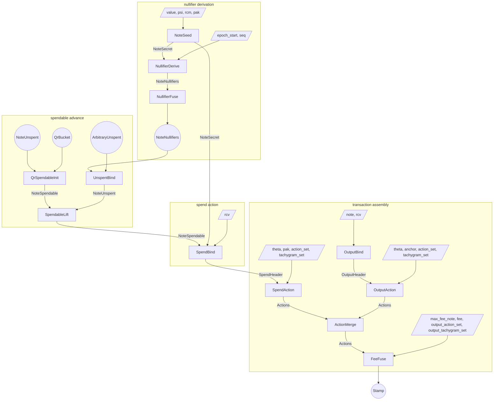
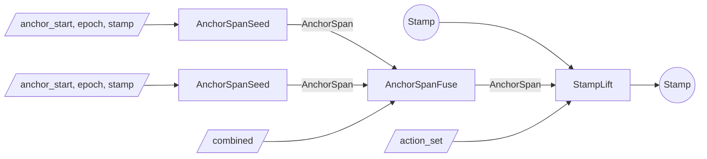
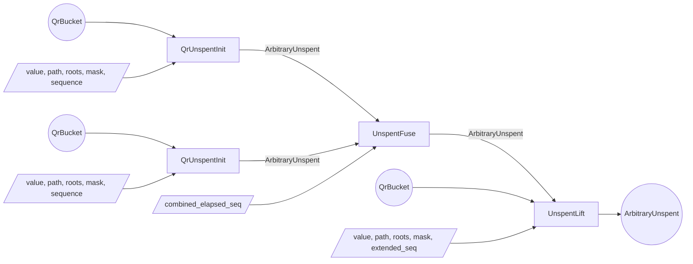

# Proof tree

Each step takes prover-supplied witnesses and up to two input PCDs and emits a PCD attesting its constraints. Wallets, sync services and aggregators can build different parts of the same tree.

## Lifecycle

### Deriving nullifiers

`NoteSeed` takes the value, trapdoors and proof-authorizing key `pak`. It derives `pk` from `pak`, `mk` from `psi` and `nk`, and `cm` from the note with `pk`. Its `NoteSecret` exposes `(cm, note, mk)` but keeps `nk` private.
`NullifierDerive` takes that seed, stages a group-aligned start epoch $e_0$, and bounds the derived end $e_0+15$ by `EPOCH_MAX`. Four $\texttt{Tachyon-NfDerive}$ sponges each squeeze four nullifiers. One opening checks the witnessed `NfSeqPoly` $g$[^nullifiers]:

$$g(\zeta) = \prod_{j < 16} F_{e_0 + j,\ \mathsf{nf}_{e_0 + j}}(\zeta)$$

`NullifierFuse` requires matching `cm` and `right.epoch_start == left.epoch_end + 1`. Checking the product of the sequences at $\zeta$ gives one `NoteNullifiers` with exactly one genuine nullifier factor per epoch in the combined inclusive range.

### Bootstrapping a spendable

`SpendableInit` takes `cm` from a `NoteNullifiers` and opens the witnessed `creation_set` polynomial to zero at `cm`, proving membership[^tachygrams]. It emits `NoteSpendable(cm, creation_epoch, anchor)` at the position immediately after the creation stamp:
$\mathsf{anchor}=\mathsf{Poseidon}_\texttt{Tachyon-AnchorSt}(\mathsf{anchor\_prev},\mathsf{creation\_epoch},x(B),y(B))$ for the creation set's bridge hash $B$. The prover chooses `anchor_prev` and `creation_epoch`; the step tests no exclusion.

### Maintaining a spendable

A spendable from `SpendableInit` spends within its creation epoch. Carrying a note into later epochs means advancing its anchor forward over `ArbitraryUnspent` segments while proving the crossed nullifiers absent.
The sync service produces `ArbitraryUnspent` segments without ever holding the note, its `cm`, or `psi`: the values a segment tests are arbitrary field elements as far as its own proof is concerned, and only `UnspentBind` attributes them to a derivation.

A `Summary` folds a run of one epoch's stamps into one accumulator alongside the anchor (`SummarySeed`, `SummaryAdvance`); summaries are note-independent, so anyone can build them.
`SummarySeed` takes a predecessor anchor, an epoch and one stamp's tachygram set from its prover, places that set in both `ACCUMULATED` and `LAST_STAMP`, and computes `anchor_end` by absorbing the epoch and the set's bridge hash into the predecessor.
`SummaryAdvance` places the next stamp's set in `LAST_STAMP`, checks at $\zeta$ that its `ACCUMULATED` equals the input's `ACCUMULATED` times that set, and absorbs the set's bridge hash to advance `anchor_end`.
Both steps hold the set's opening at $\zeta$ away from one to reject the empty set.
Provers choose where summaries start and stop, and no step joins two summaries directly. Instead, `QrSummaryIntake` converts each into an intake and `QrIntakeMerge` joins intakes where the first's `anchor_end` equals the second's `anchor_prev`.
From summaries, single stamps or an empty epoch, a builder [routes published tachygrams into buckets](#qr-epoch-evidence) by quadratic-residue profile.
Every value belongs to one class at each depth. `QrUnspentInit` requires its class bucket's contents to open nonzero at that value.
Every `ArbitraryUnspent` starts that way and covers whole epochs, half-open: `[anchor_start, anchor_next)` and `[epoch_start, epoch_next)`.
On the accepted chain the two boundary digests are the epochs' entry anchors: `anchor_next` belongs to the excluded `epoch_next`.
A segment's `elapsed` holds one member per epoch in `[epoch_start, epoch_next)`; `epoch_next`'s nullifier is the next segment's to test.
`UnspentFuse` joins two segments meeting on a shared boundary (`left.anchor_next == right.anchor_start`, `left.epoch_next == right.epoch_start`), multiplying their `elapsed` polynomials.
`UnspentLift` appends one epoch in a single step. Matching `unspent.anchor_next == bucket.anchor_start` and `unspent.epoch_next == bucket.epoch`, it tests a value against the bucket like `QrUnspentInit` and multiplies that value's indexed factor into `elapsed`.
An epoch that published nothing seals an empty bucket, so its segment is as cheap as any other.
`QrSpendableInit` starts a wallet's spendable from the bucket holding its note's creation, over the note's own QR segment for that epoch.
A builder can retain a single [evidence tree](#evidence-trees) PCD and replay a bucket from a quaternary Merkle path. Anyone can rebuild this evidence from public data.

The wallet's `UnspentBind` divides the `ArbitraryUnspent` segment's `elapsed` out of the `NoteNullifiers` sequence $g$. It commits the complement as its output `NfSeqPoly` and checks at $\zeta$:

$$g(X) = \mathsf{elapsed}(X) \cdot \mathsf{complement}(X)$$

Thus each tested factor is the note's nullifier at its own epoch, without comparing input epoch bounds. The complement holds the derived factors outside the span; `NoteUnspent` carries the span's anchors and epochs and the note's `cm`.

`SpendableLift` matches the `NoteUnspent` segment's `(cm, epoch_start, anchor_start)` to the spendable's `(cm, epoch_current, anchor)`. This preserves the note and value and leaves no gap in exclusion. Without a witness, the wallet advances the same `cm` to `(epoch_next, anchor_next)` across the whole composed segment. Only a spendable from `QrSpendableInit` or a prior lift rests on the required boundary digest.

### Spending

The wallet's `SpendBind` matches `cm` across `NoteSpendable` and `NoteSecret`.
It derives the pair `(nf_current, nf_next)` from the secret's `mk`, at the lineage's epoch and the epoch after it, and commits the note's value as `cv` under the witnessed value-randomness.
Both nullifiers are held nonzero, and the step has no assignment at the final epoch, which lacks a successor.
The output `SpendHeader` carries `cm`, the derived pair `(nf_current, nf_next)`, the threaded anchor, the note's payment key `pk`, and `cv`.

The spendable records no past nullifiers or polynomial of crossed epochs. From `SpendBind` onward no step reads the note's age: the published pair depends only on the master key and current epoch, and nothing else published outside the stamp proof depends on age.

`SpendAction` turns the `SpendHeader` into `Actions` at the spend's anchor. The witnessed proof authorizing key must derive `pk`, so `rk` belongs to the same note whose minted value `cv` commits to[^notes].
For an output, `OutputBind` witnesses the note and `OutputAction` turns its `OutputHeader` into `Actions`[^tachygrams]. Wallets typically anchor outputs at the spends' height to merge without a lift. [Stamp construction](#stamp-construction) gives both action-digest and value-commitment equations.

A transaction with multiple spend and output actions composes them with `ActionMerge`.
The output is `Actions` whose multisets are the union of the two inputs' at the shared anchor.
If a spend's lineage is at an earlier anchor of the same epoch, the wallet first runs `ActionLift` along one or more `AnchorSpan`s to move the actions to the transaction's anchor.
After the merges, `FeeFuse` applies the bundle's fee to those actions, adding the fee digest to the action set and the [fee change note](./fee.md#fee-change-note) commitment to the tachygram set, and emits a `Stamp`.
A bundle with no actions uses `FeeSeed` instead.

Before publication the wallet can advance the composed stamp along more spans.
`AnchorSpanSeed` takes a predecessor anchor, an epoch and one stamp's tachygram set from its prover, absorbs the epoch and the set's bridge hash into the predecessor to produce `anchor_end` as the sole root of its members polynomial, and holds the set's opening at $\zeta$ away from one to reject the empty set.
`AnchorSpanFuse` equates `left.anchor_end` with `right.anchor_start` and checks that the combined members polynomial multiplies the two inputs'.
For members polynomial $M$ and input anchor $a$, `ActionLift` and `StampLift` check

$$M(a) \cdot (a - \mathsf{anchor\_start}) = 0$$

so $a$ must be the start or a member. Since $M$ records no root order, both steps lift only to `anchor_end`.
`StampLift` takes its output action set from the prover and equates it at $\zeta$ with the input stamp's.
Wallets use spans published by consensus and sync services during the epoch and build their own for subsequent stamps.

On publication the bundle carries each action's descriptor and tachygram pair, the fee descriptor, the fee change commitment, the anchor, and the stamp proof. The fee descriptor and fee change commitment are separate inputs to the fee digest.
Validators reconstruct the action-set and tachygram-set commitments from those published bundles, check the proof against the reconstructed values, and confirm the anchor against the consensus chain.

After publication, an aggregator uses `StampLift` to align independently proved stamps from wallet-chosen heights at a common later anchor. Pairwise `StampMerge` adds their multisets into one **aggregate**[^aggregation], amortizing stamp verification across transactions.
The merged stamp stays with one receiving bundle and keeps that bundle's fee and fee change, and the receiver's stamp lists by `txid` the other transactions it covers, which a block holds stripped.
An innocent aggregate is itself a bundle with its own max fee note, so the aggregator proves its zero fee with `FeeSeed` and merges that stamp with the aligned stamps.
`StampUnmerge` divides one stamp by another at the same anchor, removing the divisor's leaves from the dividend.
The quotient stays with the dividend's bundle and keeps its fee and fee change. An aggregator can thus remove contributors already included in a block and continue building. Aggregates can themselves be aggregated; miners typically aggregate during block production.

### Fee states and flows

`Actions` and `Stamp` are separate headers, distinguished by suffix, so the pre-fee and post-fee states are proof-enforced.
`Actions` carries only its anchor. `Stamp` carries `(tachygram_set_bridge, anchor)`, where `tachygram_set_bridge` is the bridge hash of the tachygram set.
Both hold the action set as an `ActionSetPoly` and the tachygram set as a `TachygramSetPoly`.
Verification always rebuilds `Pcd<Stamp>`.

## Roles

- **Wallet:** runs every step that uses the note's commitment or master key, from deriving nullifiers and binding delegated evidence to building, merging and lifting actions and applying the fee.
- **Sync service:** uses pool history and shared per-epoch nullifiers to build summaries, route buckets, open evidence trees and return composed exclusion segments. The wallet gives it no note, `cm`, `psi` or `mk`.
- **Aggregator:** aligns, merges and unmerges published stamps and proves an innocent aggregate's zero fee.

| step | wallet | sync service | aggregator |
| ---- | ------ | ------------ | ---------- |
| AnchorSpanSeed | possible | yes | yes |
| AnchorSpanFuse | possible | yes | yes |
| SummarySeed | possible | yes | no |
| SummaryAdvance | possible | yes | no |
| QrSummaryIntake | possible | yes | no |
| QrStampIntakeSeed | possible | yes | no |
| QrEmptyIntakeSeed | possible | yes | no |
| QrIntakeMerge | possible | yes | no |
| QrIntakeSplit | possible | yes | no |
| QrBucketSeal | possible | yes | no |
| EvidenceTreeLeafPair | possible | yes | no |
| EvidenceTreePairFuse | possible | yes | no |
| EvidenceTreeFuse | possible | yes | no |
| EvidenceTreeCap | possible | yes | no |
| EvidenceTreeDescend | possible | yes | no |
| EvidenceTreeOpen | possible | yes | no |
| QrSideDescend | possible | yes | no |
| QrSideSelect | possible | yes | no |
| QrUnspentInit | possible | yes | no |
| UnspentFuse | possible | yes | no |
| UnspentLift | possible | yes | no |
| NoteSeed | yes | no | no |
| NullifierDerive | yes | no | no |
| NullifierFuse | yes | no | no |
| UnspentBind | yes | no | no |
| SpendableInit | yes | no | no |
| QrSpendableInit | yes | no | no |
| SpendableLift | yes | no | no |
| SpendBind | yes | no | no |
| OutputBind | yes | no | no |
| OutputAction | yes | no | no |
| SpendAction | yes | no | no |
| ActionMerge | yes | no | no |
| ActionLift | yes | no | no |
| FeeFuse | yes | no | no |
| FeeSeed | yes | no | yes |
| StampMerge | yes | no | yes |
| StampLift | yes | possible | yes |
| StampUnmerge | no | no | yes |

## Proof framework

Ragu uses the unit header for unused inputs. A header contains field elements (two affine coordinates per point), never an accumulator. Each PCD has two online polynomial slots. The header declares their types or marks them as padding; `Summary` and `QrIntakeSides` name two slots of the same type separately. Steps open left, right and output slots by name.

The challenge $\zeta$ binds both input headers, all six slot commitments and staged values, but not the output header. Steps open each slot at most once, at $\zeta$ or a fixed point such as an input field or staged witness. The bridge hash $(x(B),y(B))$ is a Pallas point binding the second output slot's commitment. An unopened output must hold the constant one; preparing anything else there cannot succeed. For an opened slot, consumers rely only on what the producer establishes.

## Soundness

A header asserts facts about its fields and two polynomial slots, not the published chain. The consensus rules below connect those assertions to any accepted stamp.

### Assumptions

Under **recursion**, joint provers of a verified PCD know its step tree and satisfying wires; an extender is credited only with its own steps. **Poseidon** has fixed arity per tag and no known collision between distinct triples of tag, absorbed elements and squeeze position. `AnchorSpanSeed` alone also models stamp absorption as a random function. **Commitments** assume no known discrete-log relation among their generators, including the value commitment bases. An accumulator thus *determines* its polynomial, a bridge hash its accumulator and a value commitment its opening: producing distinct alternatives would give a collision or discrete-log relation. Each **challenge** is modelled as a random oracle output over the preceding commitments.

**Rerandomization (privacy only).** Wallet privacy relies on rerandomization hiding the input proof beyond the public header, online polynomials and shared bootstrap proof.

### Consensus rules

1. **Anchor chain.** Consensus advances the anchor as [Anchor](./anchor.md) defines. Each stamp absorption hashes the containing block's epoch and the honest bridge hash of the stamp's tachygram accumulator, excluding stamps with empty tachygram sets. One boundary digest enters each epoch.
2. **Covered sets.** Each stamp covers its carrying bundle and the bundles named in its adjunct list. Consensus rebuilds every action and fee digest from the covered bundles, recomputes both accumulators from published members[^tachygrams], rejects duplicate actions, fee descriptors or tachygrams, and verifies the stamp proof against both accumulators and the stamp's anchor.
3. **Acknowledged anchor.** Each stamp's anchor is a canonical end-of-block anchor from the containing block's epoch or the epoch before, as [Anchor](./anchor.md#intra-block-state-vs-end-of-block-anchor) states.
4. **Two-epoch uniqueness.** No tachygram in a stamp appears in any other stamp from the containing block's epoch or the epoch before[^tachygrams].
5. **Block coverage.** Every bundle in a stamp's adjunct list is a stripped bundle in the same block, and exactly one stamp in that block names each stripped bundle[^aggregation]. Each transaction appears in at most one block on the accepted chain.
6. **Signatures and balance.** Every bundle in a block, stripped or not, carries an action signature under each action's randomized key and a binding signature over its value commitments and value balance. Consensus applies each bundle's value balance and fee once.

For rule 2, the caller resolves the adjunct list by `txid`. `Bundle::verify` checks coverage against the supplied bodies, verifies the stamp proof against the resulting claims, and checks the carrying bundle's own signatures under rule 6. It reads neither the adjunct list nor chain history.
Nodes enforce rules 1, 3, 4 and 5 against chain history.

### A canonical anchor fixes its history

An anchor is *canonical* when the accepted chain produces it.
Epoch zero's entry anchor starts the chain, and every subsequent canonical anchor is the stamp absorption or boundary digest of a single canonical predecessor.

When a header asserts a stamp absorption

$$
a' = H_\mathsf{st}(a,\ e,\ x(B),\ y(B))
$$

at a canonical $a'$, distinct tags rule out a boundary digest, so the accepted chain also produced $a'$ by a stamp absorption.
Under the Poseidon assumption both absorptions match in every input, making $a$ canonical, $e$ the containing block's epoch, and $B$ the bridge hash consensus computed.
Under the Commitments assumption, the prover's committed polynomial equals that published stamp's tachygram set polynomial.
The same matching applies to any boundary digest asserted by a header.

Consequently, any chain of stamp absorptions ending at a canonical anchor walks back step-for-step along the accepted chain's own absorptions.
Because boundary digests separate epochs on the accepted chain and open each epoch at its entry anchor, such a chain stays within one epoch and never crosses before its entry anchor.

### Anchor spans {#anchor-segments}

An `AnchorSpan`'s member roots are the anchors after `anchor_start` on its stamp chain to `anchor_end`. `ActionLift` and `StampLift` move from the start or a member to the end, so a chain connects the old anchor to the new. By the [anchor-copy and merge rules](#stamp-construction), every spend in a canonically anchored stamp came from a canonical anchor of the same epoch, no later than the stamp's.

### A sealed bucket covers its epoch

A `QrBucket` asserts an epoch-$e$ stamp chain from `anchor_start`, a boundary digest into $e$, to some $a$. Its `anchor_next` is the boundary digest of $a$ into $e+1$. If `anchor_next` is canonical, the accepted chain's unique boundary into $e+1$ fixes $a$ to the final anchor of $e$; stopping early cannot give a canonical `anchor_next`. Walking back reaches `anchor_start`, necessarily the entry anchor since no other anchor in $e$ is a boundary digest. The chain therefore contains exactly the published stamp polynomials of $e$.

The contents divide their chain's product and retain every root in the bucket's class (values matching its profile under its discriminant, one class per value at each depth). Thus with canonical `anchor_next`, every content root was published in $e$; a value in the class at which the contents do not vanish was not. `EvidenceTree` replay reproduces the sealed fields and contents and adds no further assertion.

### A spendable note

A `NoteSpendable` carrying `(cm, epoch_current, anchor)` asserts one of two forms.

- **Creation.** `anchor` is a stamp absorption in `epoch_current` of a polynomial having `cm` as a root.
- **Lineage.** Anchors run from some $e_0 < \text{epoch\_current}$ to `anchor` at `epoch_current`. Across each $e \in e_0..\text{epoch\_current}$, a bucket of $e$ between $e$'s anchor and the next epoch's anchor places `cm`'s nullifier at $e$ in its class with contents non-vanishing there, while a bucket of $e_0$ between those same first two anchors holds `cm` as a root. Matching endpoints in one epoch force identical stamp absorption chains regardless of class.

In both forms `NoteSeed` binds the note's master key to `cm` in the spendable's lineage. That key determines the note's nullifier at each epoch; `SpendableLift` needs only its two input PCDs.
Because `cm` determines its master key whereas a master key does not determine `cm`, steps joining facts about one note always equate `cm`.

When `anchor` is canonical, the creation form places `cm` among the tachygrams of the stamp absorbed at `anchor` in `epoch_current`.
In the lineage form, `anchor` is the entry anchor of `epoch_current`, so the final bucket covers its epoch from its entry anchor. Induction backward makes every bucket cover its epoch, proving `cm` was published in $e_0$ and `cm`'s nullifier at each $e \in e_0..\text{epoch\_current}$ went unpublished in $e$.

### An accepted stamp {#stamp-anchor}

Consider a stamp accepted by consensus in a block of epoch $E$.

Under rule 2, the verifier rebuilds the action accumulator from published digests, fixing the monic set polynomial and its roots with multiplicity.
`Stamp` asserts that each root is the digest of a prover-known leaf. Action digests fix `(cv, rk)` and the tachygram pair, whose tachygram tags separate output leaves from spend leaves, while fee digests use a distinct tag and fix `(cv_feemax, fee, cm_chg)`. Every published action therefore matches an output or spend leaf with its published commitment, key and pair, and every published fee matches a fee leaf.

Each output leaf ties its pair to the commitment and padding tachygram of one note with an in-range value and commits to the negated value in `cv`.

Each fee leaf commits to the max fee note's negated in-range value under the blind that note determines, bounds the fee to the note's value, and commits the same note with its value reduced by the fee as its fee change.

Each spend leaf pairs a `NoteSpendable` and `NoteSecret` sharing `cm`, publishes `cm`'s nullifiers at `epoch_current` and `epoch_current + 1`, commits to the note's value, builds `rk` from the note's spend validating key plus a prover-known generator multiple, and connects the spendable's anchor to the stamp's anchor by a chain of stamp absorptions.

Because `OutputBind`, `SpendBind`, `FeeFuse` and `FeeSeed` hold every derived tachygram nonzero, no leaf has a zero tachygram and no published tachygram set polynomial has zero as a root.

Rule 3 places the canonical stamp anchor in epoch $E$ or $E - 1$, putting the spendable's canonical anchor and absorbed `epoch_current` in that same epoch.
Thus the note was published at or before that anchor, its nullifier at every epoch from publication through `epoch_current - 1` went unpublished in that epoch, and the published pair includes its nullifier at $E$.

### No second spend

Because every spend leaf in an accepted stamp shares the stamp anchor's epoch as `epoch_current`, two spend leaves for one `cm` in the same stamp produce identical nullifier pairs, which rule 2 rejects.

Now suppose `cm` is published once and spent in two accepted stamps in epochs $E_1 \leq E_2$, with second-spend `epoch_current` $e_2$.

The first spend publishes `cm`'s nullifier at $E_1$ during $E_1$, and `cm` was published no later than $E_1$.

When $e_2 \leq E_1$, rule 3 forces $E_2 \in \{E_1, E_1 + 1\}$ and $e_2 \in \{E_1 - 1, E_1\}$, so the second spend's pair includes the nullifier at $E_1$ within one epoch of the first spend, and rule 4 rejects the second stamp.

When $e_2 > E_1$, the second spendable must take the lineage form (since creation fixes `epoch_current` to the publication epoch), spanning from publication past $E_1$ and falsely asserting that the nullifier at $E_1$ went unpublished in $E_1$.

Publishing two nullifiers is what closes the gap when a stamp uses a previous-epoch anchor, guaranteeing the pair always covers the acceptance epoch.

If `cm` is published multiple times (at least two epochs apart under rule 4), each spendable starts at one of those publications.
The argument used the single publication only to place the start of the second spendable at or before $E_1$. With several publications, the same contradiction rules out every such start. Each spend after the first must therefore start at a publication later than the previous spend, so `cm` is spent at most as many times as it is published.

Under the Poseidon assumption, any published tachygram matching a note commitment comes from an output leaf or fee change, because matching a padding tachygram or nullifier would collide across tags even though the set polynomial records no member kind.
At zero, the nonzero checks exclude such a match independently of collision resistance: no published tachygram set polynomial has a zero root.
Finally, rule 5 assigns each bundle to a single stamp in its sole block, so rule 6's binding signature balances each commitment publication once.

### A full stamp proof between parties

In the crate today, `Plan::prove` returns an uncompressed stamp. The crate can compress its proof but cannot decompress it.
The [aggregation chapter](./aggregation.md#merge-to-produce-aggregate) states the intended publication rule.

Any party holding an uncompressed stamp proof can lift, merge or unmerge it with the requisite inputs, rerandomize it, and compress it. `StampLift`, `StampMerge` and `StampUnmerge` are the only registered steps reading `Stamp`; generic rerandomization also reads it.
Lifting preserves coverage and can advance a canonical anchor within its epoch. Merging adds leaves; unmerging removes them. These operations preserve the covered transactions' `txid`s. Each step's argument applies regardless of who runs it, and the consensus conclusions apply to any stamp consensus accepts.

Bundle signatures omit the stamp, the fee and each action's tachygram pair, leaving the stamp's leaves to fix them.
Fees apply after signing ([Dynamic Fee](./fee.md)). Signatures fix the maximum via the max fee commitment; the fee leaf fixes the fee and fee change. Producing a new fee leaf requires the max fee note's opening and a fee at or below the maximum for which the circuit has an assignment. Reusing an existing fee leaf does not require its opening.
Building a new action leaf for a published action requires the action's entropy and note commitment. A delegate given all the spend witnesses and a valid spendable at a later epoch can re-prove that spend under the same value commitment and key with a new nullifier pair. Spending still requires the action signature.

An uncompressed stamp carries both set polynomials. Rule 2 binds them to the published bundles, whose digests determine the fee and output notes and each spend's master key and value.

### What the stamp proof leaves to others

- **Balance.** The stamp proof ties each value commitment to its note's value. The binding signature shows that the signed committed values sum to the bundle's value balance ([Authorization](./authorization.md), [Dynamic Fee](./fee.md)). Because a stamp covers fewer than $2^{13}$ leaves and each value is bounded by `MAX_MONEY`, the sum cannot wrap modulo the group order and the equality holds over the integers.
- **Authorization.** The stamp proof builds each spend's randomized key from the note's spend validating key, while the action signature proves knowledge of the matching signing key.
- **Reused nullifier trapdoors.** Notes sharing $\psi$ and a nullifier key have identical nullifiers[^nullifiers]. Spending one can therefore block another already-published note: it cannot reuse the published pair or prove exclusion across that spend's epoch. Wallets must avoid reuse.
- **Anchors without a spend.** A prover may choose any anchor when producing a stamp without spend leaves. Rule 3 still constrains that choice.
- **The discriminant.** Bucket exclusions hold relative to whatever first discriminant the builder chose.

## QR epoch evidence

An epoch's evidence partitions its tachygrams by a sequence of quadratic tests.
Each network's builder chooses the first discriminant $R_0$, optionally sampling it privately, and every QR header carries $R_0$ so discriminants advance by one

$$R_j = R_0 + j \quad (j = 0, \ldots, 31)$$

At discriminant $R$, a value $x$ takes the residue side when $x + R$ is a square or zero and the non-residue side otherwise. A class root $r$ satisfies

$$r^2 = m \cdot (x + R)$$

with multiplier $m = 1$ for the residue class and fixed non-residue $c$ otherwise. At $x = -R$, root zero satisfies both multipliers, so the non-residue side separately excludes $x + R = 0$.
A profile records the sequence of sides along the path to a bucket.
For a complete binary routing tree with all buckets at one depth, that depth is $\log_2$ of the bucket count. This depth estimate stays below 26 at proposed throughputs; individual buckets need not stop at the same depth. The 32-position register sets a width rather than a security level[^balance].
Builders can keep $R_0$ and intake headers private until the epoch closes and publish sealed buckets afterward.
No step restricts the builder's initial choice of $R_0$; routing preserves it.

`QrSummaryIntake` starts a depth-zero `QrIntake` from a `Summary`.
`QrStampIntakeSeed` starts one from a single stamp, as `SummarySeed` starts a summary.
`QrEmptyIntakeSeed` starts a constant-one intake from an anchor to itself for a stamp-free epoch.
`QrIntakeMerge` multiplies the contents of intakes with the same epoch, first discriminant and profile when the first's `anchor_end` matches the second's `anchor_prev`.

`QrIntakeSplit` factors an intake's contents into polynomials $q_0$ and $q_1$ in `QrIntakeSides` without requiring monic set polynomials or classifying roots.
Opening its input and two output polynomials once at $\zeta$, it checks that the contents equal $q_0 \cdot q_1$ and rejects contents opening to one so constant-one intakes seal without splitting.
It places $q_0$ and $q_1$ in the `NON_RESIDUE` and `RESIDUE` `TachygramSetPoly` slots and writes $q_0$'s bridge hash to the header.
`QrSideSelect` and `QrSideDescend` use $R=R_0+\mathsf{depth}$ from the input header without hashing or staging it. `QrSideSelect` checks $q_0(-R)\ne0$: the value $-R$ has class root zero under either multiplier but belongs on the residue side. It copies all split fields, including the bridge hash, into `QrSideSelection`. Unconstrained openings at $\zeta$ bind its `QrInterpolantPoly` and `QrQuotientPoly` slots to the prover's hints.

`QrSideDescend` matches all eight split and selection fields and stages the prover's class bit $b$ ($1$ for residue). It selects $q_b$ and tests its sibling $q$ with multiplier $m=1+b(c-1)$, opposite the one for a direct class query. Opening both sides, interpolant $u$ and quotient $h$ once at $\zeta$, it checks

$$u(X)^2 - m \cdot (X + R) = q(X) \cdot h(X)$$

An honest interpolant maps each sibling member $x_i$ to its class root: $u(x_i)=r_i$ with $r_i^2=m(x_i+R)$.

Holding the two sides' openings unequal rejects canonical sides of the same set.
One output opening at $\zeta$ checks that `QrIntake` copies the child's polynomial. The profile gadget separately requires a parent depth below 32 and appends $b$ to the parent's path.
The child divides the parent contents. Each parent root in the child's class belongs to the product but not the sibling: the identity gives every sibling root its opposite class, with the exceptional value excluded from $q_0$. The child therefore retains every such root and may also retain sibling-side roots.

No step reads a capacity, and the crate defines the steps without a builder.
Builders operate in layers, splitting intakes above capacity and merging same-profile neighbours while their product fits one polynomial. Sibling buckets can stop at different depths.

`QrBucketSeal` converts an intake over `(anchor_prev, anchor_end]` into a `QrBucket` over `[anchor_start, anchor_next)`. Its only witness is `anchor_final_prev`. It requires `intake.anchor_prev` to equal the first boundary below (which absorbs no tachygrams) and computes the second from `intake.anchor_end`:

$$\mathsf{anchor\_start} = H_\mathsf{ep}(\mathsf{anchor\_final\_prev}, \mathsf{epoch}) \qquad \mathsf{anchor\_next} = H_\mathsf{ep}(\mathsf{anchor\_end}, \mathsf{epoch} + 1)$$

Setting both inputs of the first formula to zero gives epoch zero's entry anchor.
The seal copies $R_0$, `profile` and the contents while recording `contents_hash`, and leaves the final epoch unassigned because no successor epoch exists.
Every bucket originates at `QrBucketSeal`; `EvidenceTreeOpen` replays it from a tree.

`QrUnspentInit` witnesses a nonzero tachygram $x$ and stages only $x$. Its witness also supplies 32 `path` bits $b_j$, class `roots` $r_j$ and mask bits $e_j$.
Using the queried class's own multiplier rather than the sibling's, each position enforces

$$m_j = c - (c - 1)b_j \qquad r_j^2 = m_j \cdot (x + R_j) \qquad b_j = 0 \implies x + R_j \neq 0$$

fixing $b_j$ to $x$'s class at depth $j$ with zero shifted values in the residue class.
Selecting the bucket's depth-$d$ prefix via $e_j$ and accumulating $a_j$ from zero checks the bucket's sides against $x$'s

$$\sum_j e_j = d \qquad 2 \sum_j j \cdot e_j = d \cdot (d - 1) \qquad a_{j+1} = a_j + e_j \cdot (a_j + b_j) \qquad a_{32} = \mathsf{bits}$$

while leaving positions past $d$ uncompared.
Only the first $d$ positions attain the minimum index sum $d(d-1)/2$, so the mask is fixed. The step opens only the bucket contents (nonzero at $x$) and `elapsed` (equal at $\zeta$ to the indexed factor for $(\mathsf{epoch},x)$). The resulting `ArbitraryUnspent` covers `[anchor_start, anchor_next)` and `[epoch, epoch + 1)`. `UnspentFuse` joins segments at `anchor_next`; `UnspentBind` ties the value to a note.

`QrSpendableInit` bootstraps a lineage-form spendable from the creation bucket and that epoch's `NoteUnspent` segment after `UnspentBind`.
Equating the bucket's `(epoch, anchor_start, anchor_next)` with the segment's `(epoch_start, anchor_start, anchor_next)` and checking `segment.epoch_next == bucket.epoch + 1`, it opens the bucket contents to zero at `segment.cm` without reading the profile and emits the spendable with that `cm` on `(epoch_next, anchor_next)`.

### Scaled splits: observed behavior and limits

For nonzero $k$, a scaled split replaces $(q_0, q_1)$ with $(kq_0, q_1/k)$, preserving the product and roots while changing commitments when $k \neq 1$.
Characterization tests in `crates/tachyon/tests/integration/qr.rs` record four behaviors.

- `QrIntakeSplit` accepts reciprocal factors with unchanged product, and its empty-intake check rejects contents opening to one rather than all rootless polynomials. After routing into constant side $1/7$, splitting further into $11$ and $1/77$ passes.
- `QrSideSelect` checks a nonzero exceptional-value opening preserved by nonzero scaling, and scaling sibling $q$ by $k$ with quotient $h/k$ preserves the class identity in `QrSideDescend`. Its unequal-opening check rejects identical monic sides of $(X-x)^2$ while accepting $7(X-x)$ and $(X-x)/7$ in the tested case, placing $x$ in the child under the opposite class profile.
- `QrBucketSeal` and evidence admission accept the tested scaled buckets, whereas `EvidenceTreeOpen` requires the exact leaf and rejects rescaled replays because the leaf digest absorbs `contents_hash`.
- The tested `QrUnspentInit` and `QrSpendableInit` queries distinguish zero from nonzero evaluations, which nonzero scaling preserves. Bound exclusion via `UnspentBind`, inclusion, and `SpendBind` match for the compared scaled and monic buckets. Wrong-profile exclusions still fail. A monic split carrying a stray member matches the scaled duplicate split on the tested queries.

Rejecting canonical empty and equal-sided splits, enforcing membership and profile checks, and requiring exact leaf replay are intended, whereas accepting scaled empty and equal-root splits is pinned test behavior rather than a requirement.
The tests cover finitely many cases. The `QrIntake` and `QrBucket` assertions concern roots of the contents whatever the shape of the polynomial, not just rescalings of a monic split.

### Oversized buckets: observed behavior

`QrSideDescend` stops at depth 32. Two tachygrams sharing all 32 sides cannot be separated, so their bucket is *oversized* for any builder capacity below two.

For $x=n-R_0$, the shifted value at level $j$ is $x+R_0+j=n+j$. Two matching runs of 32 quadratic characters (filing zero on the residue side) thus give colliding profiles under any discriminant offset. Exhaustive search found the two smallest positive integers matching the run of $-31$, which exercises the zero rule at level 31.
Modelling characters as independent and uniform for discriminant-independent tachygrams gives collision probability $2^{-32}$ across 32 levels.

In `crates/tachyon/tests/integration/qr.rs`, `QrSideDescend` rejects further descent for this pair, but `QrBucketSeal` seals the bucket and an evidence tree admits and replays it via `EvidenceTreeOpen`. `QrUnspentInit` rejects both members and accepts the tested nonzero absent value with the same profile. Exact exclusion is intended; the test records the current depth limit, not a circuit capacity rule.

## Evidence trees

An evidence tree lets a builder retain one root PCD for a network's sealed buckets sharing `(epoch, anchor_start, anchor_next, discriminant)`, which every evidence header carries.

`EvidenceTreeLeafPair` hashes two sealed buckets' eight header elements into leaf digests

$$\mathsf{leaf} = H_\mathsf{bkt}(e, \mathsf{anchor_{start}}, \mathsf{anchor_{next}}, R_0, \mathsf{depth}, \mathsf{bits}, x(D), y(D))$$

for `contents_hash` $D$, emitting both as half-node `EvidenceTreePair`.
Because node digests absorb four rate-filling elements under $\texttt{Tachyon-EvidNode}$ while each step reads at most two PCDs, two pair-producing steps form the halves before `EvidenceTreeFuse` hashes them (with `EvidenceTreePairFuse` pairing internal tree roots) into

$$\mathsf{root} = H_\mathsf{node}(\ell_0, \ell_1, r_0, r_1)$$

All three steps equate and copy the four network fields across their two inputs, assembling an $n$-leaf tree in $n - 1$ steps starting from at least four leaves.
Builders with fewer than four buckets repeat a bucket (which no step forbids), while single-bucket builders serve the bucket's own PCD directly.
Each `EvidenceTreeCap` hashes a root across all four node positions and raises the tree by one level. The builder repeats it until the depth is a multiple of `EvidenceTreeDescend`'s four levels. It can then keep the bucket polynomials, Merkle tree and root PCD and drop the per-bucket PCDs.

`EvidenceTreeDescend` steps down four levels by witnessing four node elements per level, equating their node digest with the current element, and selecting one via two bits. Deeper trees chain multiple descents.
`EvidenceTreeOpen` copies the network fields from the tree, witnesses the profile and contents, equates the recomputed leaf digest (including the bridge hash of the committed contents polynomial) with the descended root, and emits the `QrBucket`.
Because `EvidenceTreeFuse` and `EvidenceTreeCap` emit $\texttt{Tachyon-EvidNode}$ digests, opening one as a $\texttt{Tachyon-QrBucket}$ leaf would require a cross-tag collision, so every open follows a descent. `QrUnspentInit`, `UnspentLift` and `QrSpendableInit` consume replayed and sealed buckets identically.

Leaf digests take two rate-four permutations, node digests one. No evidence step performs scalar multiplication. Only `EvidenceTreeOpen` opens a polynomial: an unconstrained `TachygramSetPoly` opening at $\zeta$ retains the committed contents.

| Step | Permutations |
| ---- | ------------ |
| EvidenceTreeLeafPair | 4 (two leaf digests) |
| EvidenceTreePairFuse | 0 |
| EvidenceTreeFuse | 1 (node) |
| EvidenceTreeCap | 1 (node) |
| EvidenceTreeDescend | 4 (one node per level) |
| EvidenceTreeOpen | 2 (leaf digest) |

No step constrains bucket selection, count or placement. A tree may repeat one bucket everywhere, hold two buckets for one profile, or omit a class, and builders may publish different trees for the same epoch.

## Stamp construction {#stamp-construction}

A stamp commits to two multisets, an action-digest set and a tachygram set[^tachygrams].

`OutputBind` derives nonzero `cm` and `pad` from a single note with value at most `MAX_MONEY` and nonzero `rcm` (matching the nonzero `rcm` check in `NoteSeed`, `FeeFuse` and `FeeSeed`). [Tachygrams](./tachygrams.md) explains why `pad` hashes the note opening. Beside the pair, `OutputHeader` carries the negated-value commitment

$$\mathsf{cv} = [-v]\mathcal{V} + [\mathsf{rcv}]\mathcal{R}$$

`SpendBind` commits the spent note's value with opposite sign

$$\mathsf{cv} = [v]\mathcal{V} + [\mathsf{rcv}]\mathcal{R}$$

`OutputAction` reads `cv` and `cm` from `OutputHeader` and derives `alpha` from prover-chosen `theta` and that `cm`. It takes no key witness and sets `rk` to the generator times `alpha`[^keys].
`SpendAction` reads `cv` from `SpendHeader`, equates its witnessed proof authorizing key's payment key with `pk`, derives `alpha` from `theta` and `cm`, sets `rk` to `ak` plus the generator times `alpha`, and publishes the nullifier pair `SpendBind` derived from the master key.
Both emit `Actions` carrying a singleton action-digest set and a two-element tachygram set.

Both action steps compute

$$
d = \mathsf{Poseidon}_\texttt{Tachyon-ActionDg}\bigl(x(\mathsf{cv}), y(\mathsf{cv}), x(\mathsf{rk}), y(\mathsf{rk}), \mathsf{tg}_0 + \mathsf{tg}_1, \mathsf{tg}_0\mathsf{tg}_1\bigr)
$$

absorbing the exact two tachygram wires placed as roots in the tachygram set via their order-independent sum and product.

Exceeding a single step's budget splits each action across two steps. A Poseidon permutation costs roughly a seventh of a step ([ragu#720](https://github.com/tachyon-zcash/ragu/pull/720)), a 254-bit fixed-base multiplication costs roughly a fifth, and a 51-bit multiplication costs under a twentieth (`cv` uses one of each width, `rk` uses one 254-bit multiplication, and `OutputAction` and `SpendAction` also open both set polynomials).
Step budgets split as follows.

| Step | Permutations | Scalar multiplications |
| ---- | ------------ | ---------------------- |
| OutputBind | 2 (`cm`, `pad`) | 2 (`cv`) |
| OutputAction | 3 (1 `alpha`, 2 action digest) | 1 (`rk`) |
| SpendBind | 2 (nullifier pair) | 2 (`cv`) |
| SpendAction | 4 (1 `pk`, 1 `alpha`, 2 action digest) | 1 (`rk`) |

`StampMerge` and `ActionMerge` witness merged sets and check that each output set polynomial multiplies the two inputs' set polynomials.
`StampUnmerge` witnesses quotient sets and checks dividend = divisor × quotient for both polynomials. Matching digests cancel the same tachygram factors with multiplicity. Any `Stamp` at the shared anchor whose digests form a sub-multiset of the dividend's therefore divides it regardless of merge history, and the quotient may be empty.
[`FeeFuse`](./fee.md#fee-steps) converts `Actions` into a `Stamp` by multiplying each set polynomial by its linear fee factor, absorbing the same fee change commitment into the fee digest and tachygram set, while `FeeSeed` emits those two linear factors alone for a zero-action, zero-fee bundle.

`OutputAction` and `FeeSeed` witness prover-chosen anchors, `SpendAction` copies the spendable's anchor via `SpendBind` and `SpendHeader`, and `FeeFuse` copies `Actions`'s anchor. `ActionMerge`, `StampMerge` and `StampUnmerge` equate their input anchors, while `ActionLift` and `StampLift` advance an anchor matching a span's start or member to that span's end.
Every `Stamp`-emitting step writes its tachygram-set bridge hash to `tachygram_set_bridge`.

## Rerandomization at trust boundaries

Before a wallet broadcasts an autonome or an aggregator releases an aggregate, it rerandomizes the stamp proof for the same header, using fresh, unpredictable randomness and the release's shared bootstrap proof. Rerandomization precedes compression. A party verifies a received stamp before extending it.

`Plan::prove`, `ProofStamp::merge` and `ProofStamp::unmerge` each rerandomize their `Stamp` PCD. `ProofStamp::lift` does the same for nonempty spans; with no spans it returns the original stamp unchanged. `ProofStamp::compress` is a separate call.
The implementation rerandomizes no other PCD.

## Simple transaction

A transaction with one spend and one output, where the spendable was bootstrapped in a previous epoch and lifted over an `ArbitraryUnspent` crossing an epoch boundary before the spend.

The single `SpendableLift` consumes one composed `NoteUnspent` (potentially crossing many epoch boundaries); threading `cm` chains the lineage's binding to the note through every advance.

## Focused subgraphs

### Stamp anchor advance

### ArbitraryUnspent composition across epochs

## Headers

| Header | Fields | Slots |
| ------ | ------ | ----- |
| AnchorSpan | (anchor_start, anchor_end) | AnchorSetPoly: members; TachygramSetPoly |
| Summary | (epoch, anchor_prev, anchor_end) | TachygramSetPoly `ACCUMULATED`: accumulated set; TachygramSetPoly `LAST_STAMP` |
| QrIntake | (epoch, anchor_prev, anchor_end, discriminant, profile) | TachygramSetPoly: contents |
| QrIntakeSides | (epoch, anchor_prev, anchor_end, discriminant, profile, non_residue_hash) | TachygramSetPoly `RESIDUE`: residue; TachygramSetPoly `NON_RESIDUE`: non_residue |
| QrSideSelection | QrIntakeSides fields, including non_residue_hash | QrInterpolantPoly: interpolant; QrQuotientPoly: quotient |
| QrBucket | (epoch, anchor_start, anchor_next, discriminant, profile, contents_hash) | TachygramSetPoly: contents |
| EvidenceTree | (epoch, anchor_start, anchor_next, discriminant, root) | — |
| EvidenceTreePair | (epoch, anchor_start, anchor_next, discriminant, first, second) | — |
| ArbitraryUnspent | (anchor_start, epoch_start, epoch_next, anchor_next) | NfSeqPoly: elapsed |
| NoteUnspent | (cm, anchor_start, epoch_start, epoch_next, anchor_next) | NfSeqPoly |
| NoteSecret | (cm, note, mk) | — |
| NoteNullifiers | (cm, epoch_start, epoch_end) | NfSeqPoly: nullifier sequence |
| NoteSpendable | (cm, epoch_current, anchor) | TachygramSetPoly |
| OutputHeader | (cm, pad, cv) | — |
| SpendHeader | (cm, nf_current, nf_next, anchor, pk, cv) | — |
| Actions | (anchor) | ActionSetPoly: action set; TachygramSetPoly: tachygram set |
| Stamp | (tachygram_set_bridge, anchor) | ActionSetPoly: action set; TachygramSetPoly: tachygram set |

Slots lists each header's polynomial types in slot order, with the slot's name where a header holds two of one type and the contents consumers read; — marks a header whose slots are padding. A type listed without contents is one no consumer reads. `UnspentBind` keeps the complement as the `NfSeqPoly` of its `NoteUnspent`. In `AnchorSpanSeed`, `SpendableInit`, and the summary steps, the `TachygramSetPoly` in the second slot (`LAST_STAMP` in a summary) holds the stamp's set whose bridge hash the anchor absorbs: the span's seed stamp, the creation stamp, or the last stamp in the summary, respectively.

`contents_hash`, `non_residue_hash` and `tachygram_set_bridge` are bridge hashes of the producing step's second slot, a `TachygramSetPoly`. `QrSideSelection` copies `non_residue_hash` from the split, so that hash is of the split's non-residue polynomial, not of the selection's own `QrQuotientPoly`.

## Steps

| Step | Left | Right | Witness | Output |
| ---- | ---- | ----- | ------- | ------ |
| AnchorSpanSeed | — | — | anchor_start, epoch, stamp | AnchorSpan |
| AnchorSpanFuse | AnchorSpan | AnchorSpan | combined | AnchorSpan |
| SummarySeed | — | — | anchor_prev, epoch, stamp | Summary |
| SummaryAdvance | Summary | — | extended, stamp | Summary |
| QrSpendableInit | NoteUnspent | QrBucket | — | NoteSpendable |
| QrSummaryIntake | Summary | — | discriminant | QrIntake |
| QrStampIntakeSeed | — | — | anchor_prev, epoch, discriminant, stamp | QrIntake |
| QrEmptyIntakeSeed | — | — | anchor, epoch, discriminant | QrIntake |
| QrIntakeMerge | QrIntake | QrIntake | merged | QrIntake |
| QrIntakeSplit | QrIntake | — | non_residue, residue | QrIntakeSides |
| QrSideSelect | QrIntakeSides | — | interpolant, quotient | QrSideSelection |
| QrSideDescend | QrIntakeSides | QrSideSelection | class | QrIntake |
| QrBucketSeal | QrIntake | — | anchor_final_prev | QrBucket |
| QrUnspentInit | QrBucket | — | value, path, roots, mask, sequence | ArbitraryUnspent |
| EvidenceTreeLeafPair | QrBucket | QrBucket | — | EvidenceTreePair |
| EvidenceTreePairFuse | EvidenceTree | EvidenceTree | — | EvidenceTreePair |
| EvidenceTreeFuse | EvidenceTreePair | EvidenceTreePair | — | EvidenceTree |
| EvidenceTreeCap | EvidenceTree | — | — | EvidenceTree |
| EvidenceTreeDescend | EvidenceTree | — | path | EvidenceTree |
| EvidenceTreeOpen | EvidenceTree | — | profile, contents | QrBucket |
| UnspentFuse | ArbitraryUnspent | ArbitraryUnspent | combined_elapsed_seq | ArbitraryUnspent |
| UnspentLift | ArbitraryUnspent | QrBucket | value, path, roots, mask, extended_seq | ArbitraryUnspent |
| UnspentBind | ArbitraryUnspent | NoteNullifiers | complement_seq | NoteUnspent |
| NoteSeed | — | — | value, psi, rcm, pak | NoteSecret |
| NullifierDerive | NoteSecret | — | epoch_start, seq | NoteNullifiers |
| NullifierFuse | NoteNullifiers | NoteNullifiers | merged_seq | NoteNullifiers |
| SpendableInit | NoteNullifiers | — | anchor_prev, creation_set, creation_epoch | NoteSpendable |
| SpendableLift | NoteSpendable | NoteUnspent | — | NoteSpendable |
| SpendBind | NoteSpendable | NoteSecret | rcv | SpendHeader |
| OutputBind | — | — | note, rcv | OutputHeader |
| OutputAction | OutputHeader | — | theta, anchor, action_set, tachygram_set | Actions |
| SpendAction | SpendHeader | — | theta, pak, action_set, tachygram_set | Actions |
| ActionMerge | Actions | Actions | action_set, tachygram_set | Actions |
| ActionLift | Actions | AnchorSpan | — | Actions |
| FeeFuse | Actions | — | max fee note opening, fee, output action_set, output tachygram_set | Stamp |
| FeeSeed | — | — | max fee note opening, anchor, fee action_set, fee tachygram_set | Stamp |
| StampMerge | Stamp | Stamp | merged action_set, merged tachygram_set | Stamp |
| StampLift | Stamp | AnchorSpan | action_set | Stamp |
| StampUnmerge | Stamp | Stamp | quotient action_set, quotient tachygram_set | Stamp |

[^nullifiers]: See [Nullifiers](./nullifiers.md) for the nullifier sponge, the scalar `psi` seed, and the delegated absence sequence.
[^tachygrams]: See [Tachygrams](./tachygrams.md) for the per-stamp multiset polynomial and its Pedersen commitment.
[^notes]: See [Notes](./notes.md) for the four-field note structure and its commitment.
[^keys]: See [Keys](./keys.md) for the wallet key hierarchy and the per-action derivations.
[^balance]: Profiles of $x$ and $x + 1$ are shifts of one another along the progression, so two values share a bucket of depth $d$ only when $\chi(t) = \chi(t + \delta)$ across a window of $d$ consecutive $t$, about $2^{-d}$ per pair for any fixed $\delta$ by the Weil bound; for uniform tachygrams the loads are those of independent uniform assignment, and the binomial balance argument applies.
[^aggregation]: See [Aggregation](./aggregation.md) for the autonome/aggregate/adjunct lifecycle and the miner-side stripping that realizes the chain-cost reduction.
